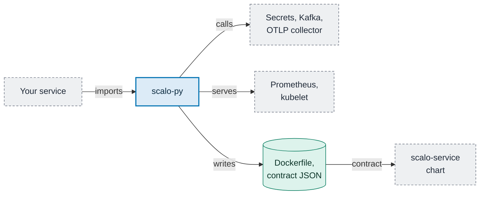

# scalo docs

The runtime layer for Python control-plane services. Import the modules you need, configure them once, and you get a 7-layer config cascade, structured logs, Prometheus + OTel metrics, K8s health probes, secrets management, resilience primitives, a Kafka client, and deployment-artefact generation. The package is [scalo](https://pypi.org/project/scalo/) on PyPI, the supported Python is `requires-python` in `pyproject.toml`, and the Rust sibling is [scalo-rs](https://github.com/hyperi-io/scalo-rs), with the same docs layout where a concept maps one to one.

This is the index. Read [architecture.md](architecture.md) for the module map, [integration.md](integration.md) for a recipe to build a scalo-based service, [auto-wiring.md](auto-wiring.md) for what wires itself, and [extras-flags.md](extras-flags.md) for which Python extras pull in which deps.

## What you get for free

| Import this | And these come along | No need to |
|-------------|----------------------|------------|
| `from scalo import config` | 7-layer cascade, env-var nesting, `.env`, YAML discovery, hot reload | Wire dynaconf, write a settings loader |
| `from scalo import logger` | After `logger.setup()`, which `ServiceApp` runs and the import alone does not: Loguru-backed structured logs, JSON unless stderr is a TTY, keyword fields in every format, RFC 3339 timestamps, gitleaks-based secret scrubbing, rate-limit filter, emoji-to-text for CI | Install loguru, format JSON, hand-roll a scrubber |
| `from scalo import metrics` | Prometheus + OpenTelemetry dual backend, `MetricsManager.metrics` + `.content_type` for an app-served `/metrics` route, process collector, opt-in cardinality cap, metric groups such as consumer, buffer, sink and circuit breaker | Stand up an exporter, wire a process collector, hand-roll a cardinality limiter |
| `from scalo import health` | `/livez` and `/readyz` router, named readiness checks, the status codes K8s probes read | Write probe handlers, manage dependency state |
| `from scalo import runtime` | K8s / Docker / bare-metal autodetect, container-aware paths (config_dir, data_dir, cache_dir, run_dir), `CONTAINER_BASE_PATH` override | Read `/.dockerenv`, parse cgroups, pick path defaults |
| `from scalo import secrets` | OpenBao / Vault / AWS / GCP / Azure / Kubernetes Secret / file providers behind one interface | Pick a provider SDK, wrap each behind a uniform API |
| `from scalo.deployment import DeploymentContract` | Pydantic contract -> Dockerfile + container manifest + Compose fragment carrying [Contract Identity v1](deployment/identity.md) labels, and the `deployment-contract.json` the scalo-service chart renders the Kubernetes objects from | Write the generators and the chart yourself, keep them in sync, stamp identity by hand |
| `from scalo.api import Hierarchy, install` | Operation ids from one resource hierarchy, the `x-scalo` spec extension, ETag/If-Match, `dry_run`, problem+json, pagination, a conformance check | Name operations by hand, hand-roll error envelopes and list paging per router |
| `from scalo.mcp import mount` | MCP tools generated from the spec, called in-process with the caller's token, writes that preview before they commit, stateless 2026-07-28 transport, RFC 9728 metadata | Hand-write a tool per route, re-implement RBAC in a second server, pin MCP clients to one replica |
| `from scalo.kafka import KafkaProducer, KafkaConsumer` | confluent-kafka clients with at-least-once producer defaults, schema sampling, consumer lag health, async wrappers | Configure librdkafka, write a lag probe |

## What scalo-py talks to

scalo-py is a library inside your process, so every arrow out of it is your service talking.

*Figure 1. L1 Context -- scalo-py. Dashed boxes are outside scalo-py.* Up: top of scalo-py. Down: [L4 Detail -- scalo-py module tiers](architecture.md#module-import-graph).

The scalo-service chart ships in scalo-rs. The Dockerfile and the container manifest have the `io.scalo.contract.*` identity labels.

## Where to read what

Config, logger and health need no extra. Metrics and tracing need the `metrics` extra.

| Area | Page | Covers |
|---|---|---|
| Start here | [architecture.md](architecture.md) | module map, dependency graph, layering |
| Start here | [integration.md](integration.md) | "I'm building a scalo service" recipe |
| Start here | [auto-wiring.md](auto-wiring.md) | what's wired automatically, what's manual |
| Start here | [extras-flags.md](extras-flags.md) | extras tree, recommended bundles, native deps |
| Start here | [migrations.md](migrations.md) | behaviour and API changes a consumer adjusts for, by release |
| Core pillars | [core-pillars/config.md](core-pillars/config.md) | 7-layer cascade, YAML discovery, hot reload, container-aware paths |
| Core pillars | [core-pillars/logging.md](core-pillars/logging.md) | loguru setup, JSON/text autodetect, fields, the JSON record's keys, rate-limit, CI mode |
| Core pillars | [core-pillars/scrubbing.md](core-pillars/scrubbing.md) | the three scrub layers and what each masks |
| Core pillars | [core-pillars/metrics.md](core-pillars/metrics.md) | Prometheus + OTel dual, metric groups, cardinality cap |
| Core pillars | [core-pillars/tracing.md](core-pillars/tracing.md) | OTLP span export, sampling, backoff when the collector is absent |
| Core pillars | [core-pillars/health.md](core-pillars/health.md) | `HealthManager`, `/livez` / `/readyz` |
| Core pillars | [core-pillars/shutdown.md](core-pillars/shutdown.md) | the K8s shutdown sequence, parallel drain, OTel and log flush |
| Runtime | [runtime/runtime-context.md](runtime/runtime-context.md) | K8s/Docker/BareMetal detection, container-aware paths |
| Transport | [transport/kafka.md](transport/kafka.md) | producer, consumer, admin, async wrappers, schema sampling, lag health |
| Deployment | [deployment/contract.md](deployment/contract.md) | `DeploymentContract` Pydantic model, schema versioning |
| Deployment | [deployment/artefacts.md](deployment/artefacts.md) | Dockerfile / container manifest / Compose / the Kubernetes objects |
| Deployment | [deployment/native-deps.md](deployment/native-deps.md) | `NativeDepsContract`, the Dockerfile APT block |
| Deployment | [deployment/keda.md](deployment/keda.md) | `KedaContract`, scaler triggers, fallback HPA |
| Deployment | [deployment/identity.md](deployment/identity.md) | Contract Identity Annotation Scheme v1 |
| Deployment | [deployment/test-support.md](deployment/test-support.md) | e2e probes, skip helper, shared test services, `KindClusterGuard` |
| API modules | [api/secrets.md](api/secrets.md) | OpenBao / Vault / AWS / GCP / Azure / Kubernetes Secret / file |
| API modules | [api/http-client.md](api/http-client.md) | `HttpClient` + `AsyncHttpClient` with retries |
| API modules | [api/concurrency.md](api/concurrency.md) | `run_blocking`, `Bulkhead`, `gather_with_timeouts` |
| API modules | [api/directory-config.md](api/directory-config.md) | YAML directory store with optional git tracking |
| API modules | [api/expression.md](api/expression.md) | CEL via Rust/PyO3 (Python/Rust evaluation parity) |
| API modules | [api/rules.md](api/rules.md) | ordered first-match rules setting target fields, with a per-call clamp and hit counters |
| API modules | [api/resilience.md](api/resilience.md) | `CircuitBreaker` Closed/Open/HalfOpen, `ReconnectingResilience` for pooled connections |
| API modules | [api/version-check.md](api/version-check.md) | non-blocking startup version probe |
| API modules | [api/scaling.md](api/scaling.md) | `ScalingPressure` composite score for KEDA |
| API modules | [api/cli.md](api/cli.md) | Typer-based CLI framework, `ServiceApp`, standard options |
| API modules | [api/api-conventions.md](api/api-conventions.md) | `scalo.api` (the `api` extra): resource hierarchy and operation ids, `x-scalo`, preconditions, problem+json, pagination, conformance check |
| API modules | [api/mcp.md](api/mcp.md) | `scalo.mcp` (the `mcp` extra): MCP tools from the spec, in-process calls, preview and commit, stateless transport, RFC 9728 |
