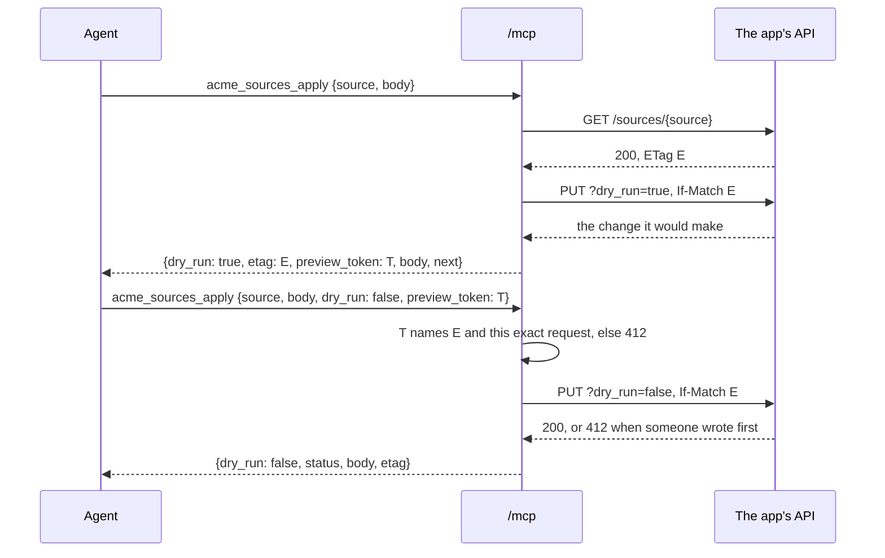

# MCP tools from the spec

`scalo.mcp` serves an MCP server on a `scalo.api` app, with one tool per operation that opts in. The tools are generated from `app.openapi()` when the app starts, and every call runs in-process through the app with the caller's own bearer token, so authentication, RBAC, If-Match, validation and audit apply exactly as they do to a direct API call. Nothing bypasses the API.

The `mcp` extra (`pip install 'scalo[mcp]'`) adds the official MCP Python SDK (`mcp`), `httpx2` and `jsonschema`, and carries `scalo[api]`. Base `import scalo` never imports `scalo.mcp`, the SDK or FastAPI, and `import scalo.mcp` without the extra raises `ImportError: scalo.mcp needs the 'mcp' extra: pip install 'scalo[mcp]'`.

```python
from scalo.api import Hierarchy, McpHints, install, scalo_extra
from scalo.mcp import mount

hierarchy = Hierarchy(base_path="/api/v1", tool_prefix="acme_")
app = FastAPI(generate_unique_id_function=hierarchy.unique_id)

@router.get("/{source}", openapi_extra=scalo_extra(mcp=McpHints()))       # tool acme_sources_get
def get_source(source: str, response: Response, view: GetView) -> Source: ...

@router.put("/{source}", openapi_extra=scalo_extra(mcp=McpHints()))       # tool acme_sources_apply
def apply_source(source: str, body: SourceSpec, pre: PreconditionHeaders,
                 dry_run: DryRun, response: Response) -> Change: ...

install(app, hierarchy)                                       # the spec carries x-scalo
mount(app, issuer="https://idp.example.com/realms/acme")      # /mcp + RFC 9728 metadata
```

Opt-in is per operation, so a large API exposes a curated tool set. The tool name is `x-scalo.mcp.tool`: the hierarchy's `tool_prefix`, then the operation id with `_` separators, or the `tool` a route declares. `tools/list` gives the tools sorted by name, so every replica lists the same tools in the same order.

## How an operation becomes a tool

| Spec | Tool |
|---|---|
| Path, query and header parameters | Arguments of the same name. A header reads as snake_case: `X-Trace-Id` is `x_trace_id` |
| `view` query parameter | `response_format` (`basic` or `full`) |
| JSON request body | `body` |
| `dry_run` query parameter, on a write | `dry_run`, default `true` |
| Every write | `preview_token`, the token its preview returned |
| `If-Match`, `If-None-Match` | Not arguments: a commit sends the precondition its `preview_token` carries, and a read takes neither |
| `Authorization`, `Accept`, `Content-Type`, `Host`, cookies | Not arguments: the in-process call sets them |
| `Forwarded`, `X-Forwarded-*`, `X-Real-IP`, `X-Oidc-*` | Not arguments: a proxy owns them, so a caller cannot claim another address or identity |
| `summary` | `title` |
| The docstring, else the summary | `description`, plus a line on how a write commits |
| `x-scalo.mcp.read_only`, `destructive` | `readOnlyHint`, `destructiveHint` |
| GET, PUT, DELETE, or read-only | `idempotentHint` |

Every input schema is JSON Schema 2020-12 with `additionalProperties: false`, and component schemas are copied into the tool's `$defs`. A call's arguments are checked against it before anything reaches the API. A path argument must be one segment, so `a/b`, `.` and `..` cannot reach another route.

## Writes: preview, then commit the previewed request

A write tool changes nothing unless the call says `dry_run: false`. The preview returns a `preview_token` naming the ETag it read and the exact request it sent. The commit sends that token back with the same arguments, so it lands only as the change that was previewed, on the state the preview saw.



| Case | Preview `etag` | Commit sends |
|---|---|---|
| The resource exists | Its current ETag, read with a GET on the same path | `If-Match: <etag>` |
| The GET answers 404 and the write takes `If-None-Match` | `*` | `If-None-Match: *`, a create that answers 412 if someone created it first |
| The write takes no `If-Match`, such as a POST action | none | No precondition |

A commit without a `preview_token` is refused before the API. One whose method, path, query, headers, body or ETag differ from what the token names answers 412 `preview_mismatch`, also before the API, so an agent cannot preview one change and commit another. The token is the ETag and an HMAC-SHA256 over the ETag and the request, keyed with the caller's `Authorization` header. A client cannot mint one from the formula, a token minted under one credential is refused under another, and a refreshed token means previewing again. A commit that carries no `Authorization` is a tool error before the API, because a token keyed with nothing can be computed. A preview needs no credential. Both calls are stateless, because the commit's arguments carry everything it needs, so any replica can serve either half.

The tool result is the API's answer: `status`, `body` (decoded JSON, or text), `etag` when the response carried one, and `dry_run`, `preview_token` and `next` on a write. A status of 400 or above sets `isError` with the problem+json body intact, so an agent sees the app's own 403 or 412. An exception in the app is the app's own 500 as a tool error, logged once: by the app's 500 handler, which `scalo.api.install` provides, or by `scalo.mcp` when the app has none. A `TimeoutError` the app raises is that 500, never the call timeout. An unknown tool is a JSON-RPC error, and a call that outlives `call_timeout` is a tool error.

## Transport

The endpoint speaks the MCP revision of 2026-07-28: `server/discover`, no `initialize`, no session, one JSON-RPC request per POST, JSON responses. `tools/list` carries `ttlMs` (`tools_ttl_ms`, default five minutes) and `cacheScope: public`, because the list is the same for every caller. Clients on the handshake-era revisions get the SDK's stateless transport. Nothing is held between requests, so a deployment runs any number of replicas with no session affinity.

Every request first passes the `Origin` check the transport requires against DNS rebinding: an `Origin` not in `allowed_origins` gets 403 `origin_not_allowed`. An entry matches on scheme, host and port exactly, and a `:*` entry matches its host with no port or any port number, never a longer host. A request with no `Origin` passes, and only browsers send one. `security_settings` hands the SDK's `TransportSecuritySettings` through for its `Host` allow-list, and its `allowed_origins` join the endpoint's. The metadata route applies the same `Origin` and `Host` rules as the endpoint.

The in-process call reuses the MCP request's `Authorization` header, scheme, host, peer address (none when the request had none) and lifespan state, so the app and its middleware see what they would for a direct call.

## Auth

With an `issuer`, a request carrying no bearer token gets 401 and the RFC 9728 challenge, `WWW-Authenticate: Bearer resource_metadata="<url>"`. The metadata naming the issuer is served at `/.well-known/oauth-protected-resource` followed by the endpoint's path, where RFC 9728 derives it from the resource identifier. It is cached publicly for an hour when `resource_url` names the resource, and privately with `Vary: Host` when the resource is read from the request.

A `token_verifier`, the MCP SDK's `TokenVerifier` (`async verify_token(token) -> AccessToken | None`), checks every request's token before any MCP handling, `tools/list` included. A token it refuses, or one past its `expires_at`, gets 401 with `error="invalid_token"`. Confirming the token was issued for this resource, its audience, is the verifier's job. Without one, the app's own check on each tool call is the only token check.

A tool call the app answers 401 gets HTTP 401 in place of a tool result, so the client re-authorises: the `invalid_token` challenge with `resource_metadata` when there is an issuer, a bare `WWW-Authenticate: Bearer` when there is none. The app's 403 stays a tool error.

## Behind a path prefix

RFC 9728 puts the metadata at the origin, ahead of the resource's path. An app served under a prefix, with ASGI `root_path` `/tenant`, has the resource `https://host/tenant/mcp`, so its challenge names `https://host/.well-known/oauth-protected-resource/tenant/mcp`. The app answers that document below its prefix, at `https://host/tenant/.well-known/oauth-protected-resource/mcp`, and the proxy's prefix route never sees the origin path. Add a proxy route sending `/.well-known/oauth-protected-resource/tenant/mcp` to the app's `/.well-known/oauth-protected-resource/mcp`. A gateway that rewrites the path any other way names the public URL in `resource_url`, and needs the same route for that URL's path.

## mount()

| Argument | Default | Meaning |
|---|---|---|
| `path` | `/mcp` | Where the endpoint is served |
| `name`, `version` | the app's title and version | What MCP clients see |
| `instructions` | none | Guidance for the model, sent with `server/discover` |
| `issuer` | none | The OAuth issuer whose tokens the app accepts |
| `scopes` | none | Scopes the metadata and the challenge list |
| `resource_url` | the request's URL | The endpoint's public URL, for a gateway that rewrites the host or path |
| `token_verifier` | none | Checks every request's token before MCP handling. Needs `issuer` |
| `allowed_origins` | none | Browser origins allowed to call, `scheme://host[:port]`, `:*` for any port |
| `security_settings` | none | The SDK's `TransportSecuritySettings`, for its `Host` allow-list |
| `tools_ttl_ms` | `300000` | How long a client may reuse `tools/list` |
| `call_timeout` | `60` | Seconds one tool call may take, its preview read included |

The routes go ahead of the app's own, so a catch-all mount cannot hide them, and stay out of the OpenAPI spec. `mount` joins the app's lifespan: the tools are generated at startup, and the endpoint answers 503 until then. Startup fails with `McpSpecError` when the spec cannot be served as tools: two tools with one name, a name MCP does not allow, an `McpHints(read_only=...)` that disagrees with the operation, a write without `dry_run`, an `If-Match` write with no GET on its path, two arguments of one tool with one name, or a schema reference that leads nowhere.

## Public API

| Name | What it is |
|---|---|
| `mount`, `McpServer` | Serve the tools on the app |
| `tools_from_spec`, `ToolSpec`, `Argument` | The generator, and one tool it builds |
| `McpSpecError` | A spec the tools cannot be served from |
| `CREATE_ETAG` | `*`, the preview etag of a missing resource |
| `PROTOCOL_VERSION`, `DEFAULT_TOOLS_TTL_MS`, `DEFAULT_CALL_TIMEOUT` | The served revision and the defaults |

scalo-rs has no counterpart: like `scalo.api`, this is a control-plane concern. See also [API-CONVENTIONS.md](API-CONVENTIONS.md) for `x-scalo`, `McpHints`, preconditions and `dry_run`, [../EXTRAS-FLAGS.md](../EXTRAS-FLAGS.md), the MCP specification revision 2026-07-28, RFC 9728 and RFC 9110.
