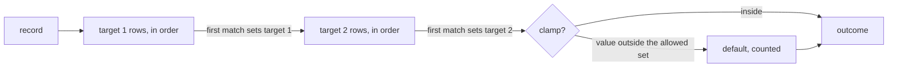

# Rules

`scalo.rules` (needs the `expression` extra) sets target fields on a record from an ordered rule set. For each target in the order the set lists them, the first row in declared order that matches the record and resolves a value sets it. A row tests the record with a native test or a CEL Fast condition, and takes its value as a literal, a copy of a field, or a field mapped through a bounded lookup table.

The format, the findings and the outcomes are scalo-rs's `scalo::rules`, checked against the same corpus (`tests/fixtures/rules_corpus.json`, vendored from scalo-rs). Every corpus case gives the same findings and outcomes in both, with two known differences:

- **Number text.** A native test or lookup reads a number's text, and Python writes a float as `repr` gives it. So `1e16` reads `1e+16` here and `1e16` in scalo-rs, `0.00001` reads `1e-05`, and `1e400` reads `inf` where scalo-rs refuses to parse the record. An integer past 2^64 stays exact here and becomes a float in scalo-rs. Rows that test integers, plain decimals, strings and booleans route the same way in both.
- **Profile scanning.** A `when` condition that hides a restricted call inside a raw or triple-quoted literal, after a `//` comment, or behind non-space whitespace before its `(` is refused here. scalo-rs accepts it until its scanner reads CEL literals and comments the same way.



---

## A rule set

```yaml
name: ingest                   # the rule_set metric label, default "rules"
targets: [_source, _org_id]    # evaluation order
lookups:
  aliases: { logs_syslog: syslog, logs_beats_winlog: windows }
rules:
  - id: category
    set: { _source: { lookup: aliases, from: tags.event.category } }
  - id: web
    match: { field: host, op: starts_with, value: web- }
    set: { _source: { value: web } }
  - id: main
    set: { _source: { value: main } }
  - id: org-tags
    match: { field: tags.event.org_id, op: exists }
    set: { _org_id: { from: tags.event.org_id } }
  - id: windows-org
    when: '_source == "windows" && has(tags.event)'
    set: { _org_id: { value: win-ops } }
```

| Key | Holds |
| --- | --- |
| `name` | The `rule_set` metric label: 1 to 128 letters, digits and `._:/@-`, starting with a letter or digit |
| `targets` | The fields the set assigns, in evaluation order, at most `MAX_TARGETS` (8) |
| `lookups.<table>` | A map of text to text. At most `max_lookup_entries` entries (100,000 by default), no empty key or value |
| `rules[].id` | Stable, unique id: the `rule` metric label and how an editor names the row. Same characters as `name` |
| `rules[].match` | A native test. With neither `match` nor `when` the row always matches |
| `rules[].when` | A CEL Fast condition, in place of `match` |
| `rules[].set` | Exactly one entry: the target field and its action |

The config is the parsed YAML or JSON mapping. A key the format does not have, or a value of the wrong type, is an error at its location, so a misspelt key never drops a test silently. Field paths are dotted (`tags.event.category`) and reach into objects, not arrays.

### Native tests

Every test but `exists` reads the field's text: a string as written, an integer or boolean as its JSON text, a float as Python writes it (`1.5`). A missing field, null, an object or an array fails every test, and so passes a negated one.

| `op` | Operands | Holds when the text |
| --- | --- | --- |
| `equals` | `value` | is `value` |
| `starts_with` | `value` | starts with `value` |
| `ends_with` | `value` | ends with `value` |
| `contains` | `value` | contains `value` |
| `prefix_and_suffix` | `prefix`, `suffix` | starts with `prefix` and ends with `suffix` |
| `length` | `min`, `max`, either open | is `min` to `max` characters long |
| `exists` | none | is present and not empty, or the field is an object or array |
| `regex` | `value` | matches the pattern. Refused unless the profile sets `allow_regex` |

`negate: true` inverts any test. `all: [...]` holds when every part does, and takes `negate` too. A test given an operand it does not take is refused.

A `regex` pattern compiles and matches on the Rust `regex` crate inside the CEL package. scalo-rs runs its own strmatch matcher, which parses patterns with the same regex-syntax crate, so both accept and refuse the same patterns, with different error text. Lookaround and backreferences are refused, an empty pattern is refused, and `$` matches only at the end of the text.

### CEL Fast conditions

`when` compiles under the expression profile ([EXPRESSION.md](EXPRESSION.md#the-expression-profile)): the options' `profile`, or `expression.*` from the config cascade when no options are given. Each top-level name the condition reads comes from an earlier target's new value, else the record. A condition that is not `true`, or fails to evaluate, does not match.

### Actions

| Action | Value | When it finds nothing |
| --- | --- | --- |
| `{ value: text }` | the literal | never, so a literal row shadows the rows its test covers |
| `{ from: field }` | the field's text | no match, the next row runs |
| `{ lookup: table, from: field }` | the table's entry for the field's text | no match, the next row runs |

Empty text reads as no value everywhere: `from` an empty field does not match, and an empty `value` or table entry is refused.

### Targets in order

A row for a later target that reads an earlier target's field reads the value this pass set, when a row set one, else the record's. An earlier target reads the record's value of a later one. So with `targets: [_source, _org_id]` an org row can test the source the same pass chose.

---

## Compile and check

```python
from scalo.expression import ProfileConfig
from scalo.rules import CompileOptions, RuleSet, RulesError

rules = RuleSet.compile(config)                     # cascade profile
rules = RuleSet.compile(config, CompileOptions(profile=ProfileConfig(allow_regex=True)))
findings = RuleSet.check(config)                    # never raises
```

One pass reports every finding, so an editor shows them all at once. `compile` raises `RulesError`, whose `diagnostics` lists them. A `RuleDiagnostic` carries:

| Field | Holds |
| --- | --- |
| `severity` | `Severity.ERROR` stops the set compiling, `Severity.WARNING` does not |
| `location` | The config location, e.g. `rules[2].match.value`, `targets[0]`, `lookups.aliases` |
| `rule` | The id of the row it concerns |
| `message` | What is wrong |
| `span` | For `when`, the byte range in the condition: the function name the profile refused, or the character the parser stopped at |

`dataclasses.asdict(finding)` gives a JSON-ready dict. The span is UTF-8 bytes, and `finding.span.utf16_offsets(condition)` gives the offsets a JavaScript editor indexes by ([EXPRESSION.md](EXPRESSION.md#locating-a-problem)). Warnings are reported once the set has no errors: a row an earlier row of the same target always fires before, because the earlier row sets a literal and is unconditional, has the same test, or is a plain `exists` on the field the later row needs. `rules.warnings` keeps the warnings of a compiled set.

---

## Evaluate

```python
from scalo.rules import Clamp

outcome = rules.evaluate(record)
outcome = rules.evaluate(record, Clamp("_org_id", allowed_orgs, "default"))
for field, assignment in outcome:
    record[field] = assignment.value
```

A record is a parsed JSON object, a `dict` or any `Mapping`.

| Outcome | Holds |
| --- | --- |
| `get(target)` / `value(target)` | The `Assignment` (`value`, `rule`), `None` when no row set it and the clamp left the record's value |
| iteration | Each assigned field with its assignment, in target order |
| `clamp` | A `ClampResult` with `outcome` `KEPT`, `REPLACED` (with `was` and `rule`) or `DEFAULTED`, `None` without a clamp |

### The clamp

`Clamp(target, allowed, default)` is per call, so each credential or listener brings its own allowed set. After every target is set, the clamp target's final value, the row's or else the record's own, is checked against `allowed`. A value outside it becomes `default` (`REPLACED`, naming the row that produced it). No value at all becomes `default` (`DEFAULTED`). The caller keeps `default` inside `allowed`, and a `frozenset` keeps the check one hash lookup.

### Counting

Every row counts the records it set its target on, and the clamp counts what it replaced, per row and for values the record carried.

| Read | From |
| --- | --- |
| `rules.usage()` | Per row, in evaluation order: `rule`, `target`, `hits`, `clamped`, since the set compiled |
| `rules.record_clamped()` | Replaced values no row set |
| `rules_hits_total{rule_set, rule}` | With `CompileOptions(metrics=manager)`, cumulative across reloads |
| `rules_clamped_total{rule_set, rule}` | Same. `rule="(record)"` (`RECORD_LABEL`) for a value the record carried |

`rules.evaluate` takes a lock per record to count. `with rules.batch() as batch:` counts each `batch.evaluate` locally and adds the totals once, at `batch.flush()` or when the block ends. A set is safe to share between threads.

---

## Reload

```python
rules = RuleSet.from_file_section("config.yaml", "routing.rules")
```

`from_file_section` reads the YAML file and compiles the section at the dotted key. A file that cannot be read or parsed, or has no such section, raises `RulesLoadError`. A section that does not compile raises `RulesError` with its findings. To reload a set the app keeps in its config cascade, compile it in the `ConfigReloader` `validate_fn`, which keeps the last good config when it returns false ([../core-pillars/CONFIG.md](../core-pillars/CONFIG.md#hot-reload)).

---

## Related

- [EXPRESSION.md](EXPRESSION.md) -- the CEL Fast profile and `diagnose`
- [../core-pillars/CONFIG.md](../core-pillars/CONFIG.md#hot-reload) -- `ConfigReloader`
- [../core-pillars/METRICS.md](../core-pillars/METRICS.md) -- the `MetricsManager` the counters register with
- scalo-rs `docs/pipeline/rules.md` -- the same rule set in Rust, over raw JSON bytes
