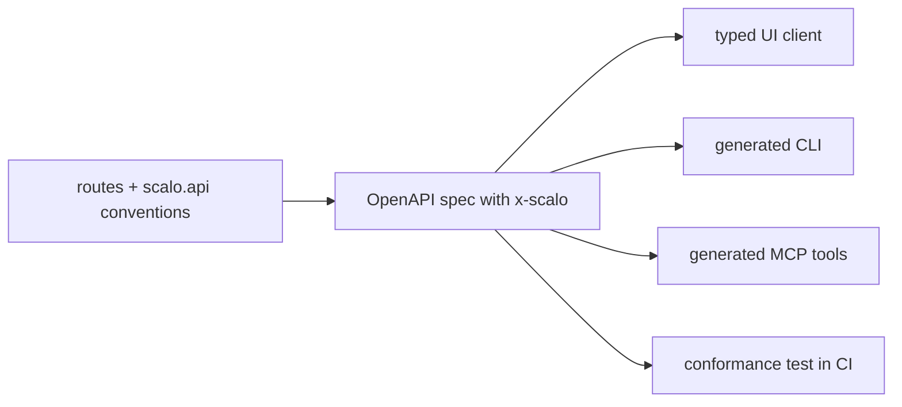

# API conventions

`scalo.api` holds a FastAPI service to one set of API conventions. One resource hierarchy names every operation, so the OpenAPI spec, a CLI and MCP tools generated from it group and name things the same way. It supplies the operation ids, the `x-scalo` OpenAPI extension, ETag and If-Match, `dry_run`, RFC 9457 problem+json errors, list pagination, `view`, and a conformance check that fails a test when a route drifts.

```bash
pip install 'scalo[api]'
```

The `api` extra adds `fastapi` and `pydantic`. Base `import scalo` never imports `scalo.api` or FastAPI, and `import scalo.api` without the extra raises `ImportError: scalo.api needs the 'api' extra: pip install 'scalo[api]'`.



---

## Quick start

```python
from fastapi import APIRouter, Depends, FastAPI, Response

from scalo.api import (
    DryRun, Hierarchy, ListParams, Page, PreconditionHeaders,
    etag_of, install, paginate, permission,
)

hierarchy = Hierarchy(base_path="/api/v1", singletons={"deployment"})
app = FastAPI(generate_unique_id_function=hierarchy.unique_id)

def require(action: str):
    @permission(action)                     # names the action in the spec, the check stays yours
    def check() -> None: ...
    return check

router = APIRouter(prefix="/sources")

@router.get("", dependencies=[Depends(require("source:read"))])
def list_sources(query: ListParams) -> Page[Source]:          # sources.list
    """List sources."""
    return paginate(store.find(query.filter, query.order_by), query)

@router.put("/{source}", dependencies=[Depends(require("source:write"))])
def apply_source(source: str, body: Source, pre: PreconditionHeaders,
                 dry_run: DryRun, response: Response) -> Source:   # sources.apply
    """Create or replace a source."""
    pre.check(store.etag(source))           # None when it does not exist yet
    response.headers["ETag"] = etag_of(body)
    if not dry_run:
        store.write(source, body)
    return body

app.include_router(router, prefix="/api/v1")
install(app, hierarchy)                     # problem+json handlers + annotated spec
```

`install` refuses an app built without `generate_unique_id_function=hierarchy.unique_id`. It wraps whatever `app.openapi` is when called, so assign a custom one first, or call `annotate_openapi(spec, app.routes, hierarchy)` and `declare_problem_responses(spec)` inside it.

---

## The hierarchy

Resource names alternate collection and id, after Google AIP-122: `sources/{source}/rules/{rule}`. Collections are plural and kebab-case. A singleton has no id and may have children: `deployment`, `orgs/{org}/usage`. Nest only for ownership, a child whose life ends with its parent. The operation id is the resource names, then the verb, below the base path:

| Method and path | Operation id | Why |
|---|---|---|
| `GET /sources` | `sources.list` | GET on a collection |
| `POST /sources` | `sources.create` | POST on a collection |
| `GET /sources/{source}` | `sources.get` | GET on an id |
| `PUT /sources/{source}` | `sources.apply` | PUT creates or replaces |
| `PATCH /sources/{source}` | `sources.update` | |
| `DELETE /sources/{source}` | `sources.delete` | |
| `GET /sources/{source}/rules` | `sources.rules.list` | child collection |
| `POST /sources/{source}/deploy` | `sources.deploy` | POSTed literal that is not plural: an action |
| `POST /orgs/{org}/members` | `orgs.members.create` | POSTed plural: a create |
| `POST /sources/{source}/rules/order` | `sources.rules.order` | literal after a collection with no id: an action |
| `GET /deployment` | `deployment.get` | declared singleton |
| `POST /deployment/sync` | `deployment.sync` | action on a singleton |

An action (an AIP-136 custom method) is a GET or a POST. Starlette's `{id}` matches `:`, so actions are a path segment, not the AIP `:verb` suffix. Cross-parent listing uses the `-` wildcard as the id value (`sources/-/rules`), not a second route.

What the path cannot say is declared. A GET action reads as a child collection unless its verb is declared:

```python
@router.get("/{source}/preview", openapi_extra=scalo_extra(verb="preview"))   # sources.preview
```

A declared verb equal to the trailing literal makes that literal the action. A different one replaces the derived verb.

`Hierarchy` arguments:

| Argument | Default | Meaning |
|---|---|---|
| `base_path` | `""` | Prefix every path carries, part of no name |
| `singletons` | none | Resource names with no id |
| `roots` | any | Root resources the API may declare |
| `max_depth` | 3 | Most resource levels a path may name |
| `plurals` | `DEFAULT_PLURALS` | Extra plural names that do not end in `s` |
| `tool_prefix` | `""` | Prefix of the derived MCP tool name |

A name is plural when its last word ends in `s` but not `ss`, `us` or `is`, or is listed in `plurals` or `DEFAULT_PLURALS` (`children`, `criteria`, `data`, `indices`, `media`, `metadata`, `people`). `Hierarchy.parse(path, method, verb=None)` returns the `OperationName` (`hierarchy`, `verb`, `group`, `resource`, `depth`, `operation_id`, `problems`) for any path. `unique_id` never raises: a path that breaks a rule still gets an id, and the conformance check reports the rule.

---

## The `x-scalo` extension

`annotate_openapi` writes one object onto every operation. It is derived from the path, the route's declarations and its permission dependencies, and is never written by hand:

| Key | Value |
|---|---|
| `group` | The root resource: the CLI group and the MCP namespace |
| `resource` | The resource the verb acts on |
| `hierarchy` | Resource names from the root |
| `verb` | The standard method or the action |
| `read_only` | True for GET, HEAD and OPTIONS, or as declared |
| `cli` | `{hidden, aliases, positional}`, defaults `false`, `[]`, `[]` |
| `mcp` | Present only when the route opts in: `{tool, read_only, destructive, task}` |
| `action` | The RBAC action the route checks, a list when it checks several |
| `public` | `true` when the route takes no permission check |

A route declares through `openapi_extra=scalo_extra(...)`:

| Argument | Declares |
|---|---|
| `verb` | The action a GET names, or a verb the path cannot derive |
| `public` | No permission check. Refused alongside `action` |
| `action` | The action a handler checks itself, for a check that is not a dependency |
| `read_only` | A POST that changes nothing |
| `cli` | `CliHints(hidden=False, aliases=(), positional=())` |
| `mcp` | `McpHints(tool=None, read_only=None, destructive=None, task=False)`. Passing it opts the operation in. `tool` defaults to `tool_prefix` plus the id with `_` separators, `destructive` to DELETE |

The permission hook keeps scalo out of the consumer's roles. Decorate the dependency that performs the check with `permission(action)`. Every route whose dependency tree reaches it, through its own dependencies, a router's or a nested one, carries that action. The tag is the `ACTION_ATTRIBUTE` attribute on the callable.

---

## Writes: apply, preconditions and dry_run

One `apply` (PUT) creates and updates, after AIP-133, AIP-134 and AIP-154. The client sends `If-None-Match: *` to create and `If-Match: <etag>` to update. `PreconditionHeaders` reads both, and `pre.check(current_etag)` evaluates them in the RFC 9110 section 13.2.2 order: If-Match with strong comparison, then If-None-Match with weak comparison.

| Outcome | Status | `code` |
|---|---|---|
| If-Match does not match | 412 | `etag_mismatch`, with the current `etag` |
| If-Match on a resource that does not exist | 412 | `resource_missing` |
| If-None-Match matches, or is `*` on an existing resource | 412 | `resource_exists`, with the current `etag` |
| Neither header sent | 428 | `precondition_required` |
| A header that is not an entity-tag list | 400 | `invalid_precondition` |

`check(current, require=False)` lets a write with neither header through. `check_preconditions` is the same check as a function. `etag_of(value)` is the SHA-256 of bytes or text as given, and of anything else as canonical JSON, so key order does not change it. `format_etag(value)` quotes an opaque value such as a git blob sha. `parse_etags(header)` returns `"*"` or a tuple of `EntityTag`.

`DryRun` is the `dry_run` query parameter, default false, after AIP-163. A handler given `dry_run=true` validates, reports the change and the ETag it would write, and commits nothing. To bind a commit to the state its preview saw, a client sends the resource's current ETag, the one the preview was computed against, as `If-Match` on both the preview and the commit: the commit then answers 412 if anyone wrote in between. The ETag it would write cannot serve, because `If-Match` is compared with the current one. `If-Match` binds the state, not the change, so a commit that should be exactly the previewed request needs the client to bind that too. `scalo.mcp` does both, with a preview token over the ETag and the request ([mcp.md](mcp.md)).

`dry_run` is a parameter the handler must honour. scalo does not turn the request into a no-op, and the `dry-run` conformance rule checks only that the parameter is declared.

---

## Lists and views

`ListParams` reads the four AIP-158 list parameters into a `ListQuery`:

| Parameter | Meaning |
|---|---|
| `page_size` | 0 or absent gives the default (50). Above the cap (1000) is cut to it. Negative is refused with 422 |
| `page_token` | The previous page's `next_page_token` |
| `filter` | Filter expression, in the API's own syntax |
| `order_by` | Ordering, such as `name desc` |

`list_query(default_page_size=..., max_page_size=...)` builds the dependency with other limits, and refuses a default outside the cap at startup. A list answers `Page[T]`: `items`, `next_page_token` (`None` on the last page) and an optional `total_size`. `paginate(items, query, with_total=True)` cuts a page out of a list the server already filtered and ordered. The token is opaque to clients and bound to the `filter` and `order_by` it was issued for, so a changed filter between pages answers 400 `invalid_page_token`, as does a token the API did not issue. A token is not a security boundary: decoding one shows only an offset. `page_size` may change between pages.

`View` is `basic` or `full`, after AIP-157. `ListView` defaults to `basic` and `GetView` to `full`.

---

## Errors: problem+json

`install_problem_handlers(app)` answers every error with `application/problem+json`, RFC 9457:

```json
{"type": "about:blank", "title": "Unprocessable Content", "status": 422,
 "detail": "The request has 1 invalid field(s)", "code": "validation_error",
 "errors": [{"field": "size", "location": "body", "detail": "Field required",
             "code": "missing", "pointer": "#/size"}]}
```

| Raised | Answer |
|---|---|
| `ProblemError(status, detail, code=..., errors=..., headers=..., **extensions)` | That problem. An extension may not reuse `type`, `title`, `status`, `detail` or `instance` |
| `HTTPException` with text | `detail` is the text. Headers are kept |
| `HTTPException` with a dict | `code` and `message` (or `detail`) become `code` and `detail`. Other keys, `errors` aside, become extension members |
| Request validation | 422 `validation_error`, one `FieldError` per field (AIP-193): `field`, `location`, `detail`, `code`, and `pointer` for a body field |
| Anything else | 500, logged with the route template, never echoing the exception's message. `catch_unhandled=False` leaves it to the server |

`install` registers handlers for `StarletteHTTPException`, `RequestValidationError` and, unless `catch_unhandled=False`, `Exception`. FastAPI keeps the last handler registered per exception, so these replace any the app registered earlier. Pass `problem_handlers=False` to keep the app's own.

`declare_problem_responses(spec)` makes the spec say the same: it adds the `Problem` schema, points FastAPI's default 422 at it, adds a `default` problem response where an operation has none, and drops FastAPI's validation-error schemas once nothing references them. `install` does both.

The schemas dropped are `HTTPValidationError` and `ValidationError`. A client generated from the spec that names them must move to the `Problem` schema.

---

## Conformance

`check_conformance(app, hierarchy, allow=..., exempt=..., spec=None)` walks `app.routes` and the spec and reports each operation that breaks a rule. `assert_conformant(...)` raises `AssertionError` with the report, for a test:

```python
def test_api_conformance():
    assert_conformant(app, HIERARCHY, allow=KNOWN_VIOLATIONS,
                      exempt=["/scim/*", "/.well-known/*", "/api/v1/auth/*"])
```

| Rule | Fires on |
|---|---|
| `operation-id` | No operationId, one not shaped `<root>.<child...>.<verb>`, or one other than the derived id |
| `duplicate-operation-id` | One id on two operations |
| `hierarchy` | A path that breaks a resource-name rule: kebab-case, plural collections, parameter position, base path, declared roots, a method with no standard verb |
| `depth` | More resource levels than `max_depth` |
| `extension` | `x-scalo` missing, or different from what the route declares |
| `response-model` | No response model on a status with a body |
| `summary` | Neither a summary nor a docstring |
| `permission` | No `x-scalo.action` and not public |
| `pagination` | A list without `page_size` and `page_token`, or whose response has no `next_page_token` |
| `dry-run` | A mutation, anything not read-only, without `dry_run` |
| `if-match` | A PUT, PATCH or DELETE without the `If-Match` header |

`exempt` takes patterns over route paths for protocol routes whose shape a standard fixes, such as SCIM, OIDC or `.well-known`. `allow` takes patterns over a violation's key, `"<rule> <METHOD> <path>"`, so an API adopts the conventions router by router: `"* * /api/v1/sigma/*"` allows a whole router. `report.allow_list()` returns the keys that would pass today, which is the starting allow-list. An entry that matches nothing fails the check (`strict=False` tolerates it), which keeps the list shrinking to empty. `spec=` checks a committed copy of the spec instead of `app.openapi()`.

---

## Public API

| Name | What it is |
|---|---|
| `Hierarchy`, `OperationName`, `DEFAULT_PLURALS` | The naming model and one parsed name |
| `EXTENSION`, `scalo_extra`, `CliHints`, `McpHints` | The `x-scalo` key and route declarations |
| `permission`, `ACTION_ATTRIBUTE` | The permission hook |
| `annotate_openapi`, `install` | Write `x-scalo` onto a spec, wire an app |
| `PreconditionHeaders`, `Preconditions`, `check_preconditions` | If-Match and If-None-Match |
| `etag_of`, `format_etag`, `parse_etags`, `EntityTag` | Entity-tags |
| `DryRun`, `View`, `ListView`, `GetView` | Shared query parameters |
| `ListParams`, `ListQuery`, `list_query`, `Page`, `paginate`, `encode_page_token`, `decode_page_token`, `DEFAULT_PAGE_SIZE`, `MAX_PAGE_SIZE` | Pagination |
| `ProblemError`, `Problem`, `FieldError`, `problem_response`, `install_problem_handlers`, `declare_problem_responses`, `PROBLEM_MEDIA_TYPE` | problem+json |
| `check_conformance`, `assert_conformant`, `ConformanceReport`, `Violation` | The conformance check |

scalo-rs has no counterpart: this is a control-plane concern, and scalo-rs serves the data plane.

---

## Related

- [../extras-flags.md](../extras-flags.md)
- [mcp.md](mcp.md)
- [cli.md](cli.md)
- [../core-pillars/health.md](../core-pillars/health.md)
- Google AIPs 122, 132 to 136, 154, 157, 158, 163 and 193: <https://google.aip.dev>
- RFC 9110 (conditional requests) and RFC 9457 (problem details)
