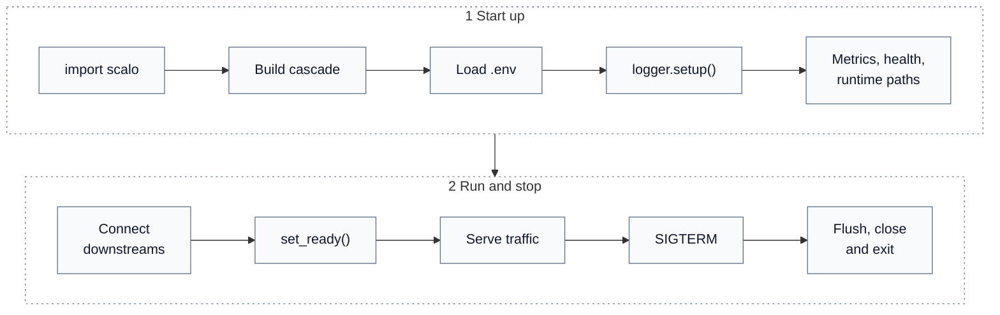

# Auto-wiring

What scalo-py does automatically when you import a module or call its entry point, versus what you wire by hand. Defaults that work as they are, and an argument or a setting wherever you need to change one.

## What's automatic

| Module | Wired at | What's automatic |
|---|---|---|
| `config` | Any scalo import (`src/scalo/__init__.py` imports `config`) | Dynaconf cascade construction, YAML file discovery, container detection and the `MountConfig` paths |
| `.env` layer | `get_config()` or `ServiceApp.cli()` | `./.env` (plus `~/.env` under `DOTENV_CASCADE`) loaded into `os.environ` beneath any variable set before it. Importing scalo reads no `.env` and never writes `os.environ` |
| `logger` | `logger.setup()`, which `ServiceApp` runs | Sinks installed, JSON/text autodetect (TTY vs not), RFC 3339 timestamps, level from `LOG_LEVEL`, then `logging.level`, then INFO, scrub rules loaded from `src/scalo/data/gitleaks.toml` and `src/scalo/data/national_ids.toml`, CI mode autodetect (`CI`, GitHub Actions, GitLab CI, Jenkins, CircleCI, Travis) for ASCII-only output. Importing the module installs nothing beyond turning off loguru's `diagnose` on its default sink |
| `runtime` | Each `get_runtime_paths(app_name)` call | K8s / Docker / BareMetal detection (7 indicators), directory creation (`ensure_dirs=True`), `CONTAINER_BASE_PATH` env override |
| `metrics` | Each `create_metrics(app_name)` call | Backend selection (OTel default, Prometheus fallback if OTel not installed), `MetricsManager.metrics` + `content_type` for the observability server or an app-served route, prometheus_client's process collector on `/metrics`. The cardinality cap is NOT automatic -- see [core-pillars/metrics.md](core-pillars/metrics.md) |
| `health` | `HealthManager()` | Probe state ready. `/livez` is 200 until a registered liveness check fails, and `/readyz` returns 503 until `set_ready()` is called and all registered downstream checks pass |
| scrub metrics | `ServiceApp` `run`, once the metrics manager exists | The log scrub layers emit `log_scrub_matches_total`, `log_scrub_redactions_total`, `log_scrub_errors_total`, `log_scrub_skipped_rules_total`, `log_scrub_duration_seconds` and `log_scrub_pattern_version`. `ServiceApp` re-runs `logger.setup(metrics=...)` after `create_metrics` to wire them. Outside `ServiceApp` pass `metrics=` to `setup()` yourself, or the layers stay no-op. Honours `scrub.metrics_enabled` and `scrub.metrics_type_cardinality_cap` |
| resource metrics | `ServiceApp` `run`, once the metrics manager exists | `ResourceMetrics`: psutil process gauges and cgroup container gauges, read at every collection |
| observability port | `ServiceApp` `run` (unless `serve_observability = False`) | Binds `--metrics-addr` (default `0.0.0.0:9090`) and serves `/metrics`, `/livez` and `/readyz` -- and nothing else -- off `app.health()` and the auto-initialised metrics manager. A bind failure is fatal by design |
| `version_check` | `check_on_startup(product, version)` call | Daemon thread fires-and-forgets a probe to the app's configured `version_check.api_url`, and does nothing without one. It never blocks and never raises |
| `secrets` | `SecretsManager.from_config(config)` | One provider per backend key in the dict (`openbao` or `vault`, `aws`, `gcp`, `azure`, `kubernetes`), plus `file` always. Each named source picks its provider. A provider with its SDK missing is left out with a warning |

## What's manual

| Concern | You wire | Why not automatic |
|---|---|---|
| Health routes on your FastAPI app | `app.include_router(create_health_router(...))` for `/livez` and `/readyz` | scalo-py doesn't control your HTTP framework. `/metrics` there is served by the app from `MetricsManager.metrics` + `content_type` (see core-pillars/metrics.md). No `/config` router ships |
| Kafka producer flush on shutdown | `producer.flush()` in your signal handler | Producer lifecycle is app-specific, and we don't intercept SIGTERM |
| Circuit breaker around a downstream | `with CircuitBreaker("name", config): call()` | Failure modes vary per downstream. The defaults are sensible, but explicit is better |
| Metric registration | `m.counter(name, description, labels)` per metric | Metrics are app-specific: we provide the framework, not the catalogue |

## What each extra adds

Each extra adds its row to the base install. Extras do not include each other, except `mcp`, which pulls in `api`.

| Install | Adds | Automatic |
|---|---|---|
| `scalo` (base) | `config`, `logger`, `runtime`, `cli`, `health`, `version_check`, `concurrency`, `resilience`, `scaling` | Cascade, structured logs, path detection, version probe, the observability listener |
| `scalo[metrics]` | `metrics` + `prometheus-client` + `psutil` + OTel SDK/exporters | The default OTel backend: OTLP push AND `MetricsManager.metrics` for the observability server or an app-served `/metrics` route, plus process gauges (cardinality cap is opt-in) |
| `scalo[opentelemetry]` | OTel SDK + exporters | Subset of `[metrics]`, kept for existing pins |
| `scalo[http]` | `http` + `httpx` + `stamina` | HTTP client with retry and jitter. A circuit breaker is yours to wrap around it |
| `scalo[kafka]` | `kafka` + `confluent-kafka` + `genson` | Producer/consumer/admin + schema sampling. Consumer-lag health is MANUAL: `KafkaConsumer` does not install the statistics callback, so `KafkaConsumerHealth` and the `kafka.health.*` keys stay inert until the app wires `create_stats_callback` itself |
| `scalo[secrets-{vault,aws,gcp,azure,kubernetes}]` | one provider's SDK | That provider behind the uniform interface, imported lazily |
| `scalo[deployment]` | `deployment` + `pydantic` | `DeploymentContract` + generators + `ContractIdentity` + `test_support` |
| `scalo[expression]` | `expression` + `common-expression-language` | [CEL](https://github.com/cel-expr/cel-spec/blob/master/doc/langdef.md) evaluation, the same crate scalo-rs evaluates with |
| `scalo[api]` | `api` + `fastapi` + `pydantic` + `cryptography` | `install(app, hierarchy)`: problem+json handlers and a spec with operation ids and `x-scalo` from the resource hierarchy. The app still passes `generate_unique_id_function=hierarchy.unique_id` itself |
| `scalo[mcp]` | `mcp` + the MCP SDK + `httpx2` + `jsonschema`, and `[api]` | `mount(app)`: MCP tools generated from the spec at startup, each call run in-process with the caller's token, writes that preview first and commit only the previewed request, and an `Origin` check. Naming an issuer adds RFC 9728 metadata and the token challenge |
| `scalo[resilience]` | `stamina` | The stamina retry engine without the HTTP client. `scalo.resilience` itself needs no extra |
| `scalo[cli]` | `cli.openapi` + `typer` + `jmespath` | A whole CLI from an OpenAPI spec alone: the resource hierarchy as the command tree, `--output`, `--query`, pagination, input documents, problem+json exit codes |

## Lifecycle

A service reads no `.env` until it asks for config, and stays out of the load balancer until it calls `set_ready()`.

*Figure 1. L4 Detail -- Service lifecycle. Read each stage left to right, then down.* Up: [scalo docs](README.md).

`get_config()` or `ServiceApp.cli()` loads the `.env` file, and `ServiceApp` runs `logger.setup()` and creates the metrics and health managers. Connecting downstreams, `set_ready()` and the shutdown steps are the app's code.

- The import-time work reads files and nothing else: the cascade's YAML, `/proc` for container detection, and a stat of each candidate mount directory. It never writes `os.environ`, so apps can `import scalo.config` from a `__init__.py` without startup latency surprises.
- `set_ready()` is explicit, not inferred. Until you call it, `/readyz` returns 503, which is what a K8s rolling update wants.
- SIGTERM handling is the app's job. scalo has `concurrency` primitives (`Bulkhead`, `gather_with_timeouts`, `run_blocking`) but installs no SIGTERM handler. [shutdown.md](core-pillars/shutdown.md) shows the wiring.
