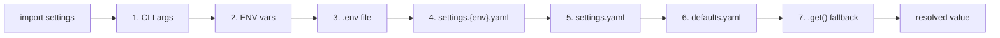

# Config

Seven-layer configuration cascade backed by Dynaconf. Import `settings`,
read it like a dict, and every value resolves through CLI args, env
vars, `.env`, per-environment YAML,
base YAML, defaults YAML, and hard-coded fallbacks -- in that order.
Every scalo-py-based service shares this cascade so the same `LOG_LEVEL`,
`MYAPP_DATABASE_HOST`, or `settings.production.yaml` key behaves
identically across daemons, CLIs, and Kafka consumers.

---

## The cascade

| # | Layer | Source | When it wins |
|---|-------|--------|--------------|
| 1 | CLI args | `--host prod.db.com` (Typer/Click) | One-shot runtime override |
| 2 | Env vars | `MYAPP_DATABASE_HOST=...` | Deployment-injected |
| 3 | `.env` file | `./.env` (or `~/.env` + `./.env` with `DOTENV_CASCADE=true`) | Local dev secrets, gitignored |
| 4 | `settings.{env}.yaml` | Per-environment overlay (e.g. `settings.production.yaml`) | Environment-specific |
| 5 | `settings.yaml` | Project base | Team defaults |
| 6 | `defaults.yaml` | Safe fallback | Local dev |
| 7 | Hard-coded | `settings.get("k", "default")` | Last resort |

### When `.env` loads

Importing scalo reads no `.env` and never writes `os.environ`. Layer 3 loads when the app asks: `get_config()` (default `load_dotenv=True`) or `ServiceApp.cli()`, which loads before parsing so `LOG_LEVEL`, `LOG_FORMAT`, `METRICS_ADDR` and `CLI_CONFIG` see it.

Loaded values go into `os.environ` beneath every variable already exported, and `settings` reloads if something read it first. An app that reads only `settings` calls `get_config()` once at startup. `get_config(load_dotenv=False)` skips the layer.

---

## Read it like a dict

```python
from scalo.config import settings

# Attribute access, dot-separated keys.
brokers = settings.kafka.brokers
batch_size = settings.processor.batch_size

# Dict-style with fallback (recommended for optional keys).
host = settings.get("database.host", "localhost")
timeout = settings.get("api.timeout", 30)
```

Env keys are auto-generated from the dotted path:

| Config path | Env key (prefix `MYAPP`) |
|-------------|--------------------------|
| `database.host` | `MYAPP_DATABASE_HOST` |
| `cache.disk.enabled` | `MYAPP_CACHE_DISK_ENABLED` |
| `kafka.brokers` | `MYAPP_KAFKA_BROKERS` |

The prefix comes from `ServiceApp(env_prefix=...)` / `set_env_prefix()`,
then the bare `ENV_PREFIX` env var, then bare -- no prefix at all, so the
key above is just `DATABASE_HOST`. scalo hard-codes no brand.

---

## Multi-file discovery

For each YAML layer (`defaults`, `settings`, `settings.{env}`), scalo-py
searches four locations and merges every file found, later overriding
earlier:

1. `./` -- current directory
2. `./config/` -- project config subdir
3. `/config/` -- container ConfigMap mount
4. `~/.config/{app_name}/` -- XDG user config

Both `.yaml` and `.yml` extensions are checked (`.yaml` wins on tie).
App name resolves from the bare `APP_NAME` env var (the K8s/Docker convention), then the prefix-aware `<PREFIX>_APP_NAME`, then the program name, then `"app"`. The program name is the top-level package for `python -m pkg[.mod]`, else the stem of the script or console entry point, with underscores turned into hyphens. `python -c`, `python -`, an empty `argv[0]`, `__main__`, `pytest` and `python` give no name. Nothing is imported to guess one, so set `APP_NAME` wherever the name matters.

App environment resolves from `APP_ENV`, `ENVIRONMENT`, `ENV`, then `"development"` -- each candidate is trimmed, and a blank value is treated as unset.

---

## Env-var substitution in YAML

```yaml
database:
  host: ${POSTGRES_HOST:-localhost}
  port: ${POSTGRES_PORT:-5432}
  password: ${POSTGRES_PASSWORD}    # No default -- KeyError if unset

logging:
  level: ${LOG_LEVEL:-INFO}
```

Default-value syntax matches shell: `${VAR:-default}`. No default
means the var must be set or Dynaconf raises.

---

## Hot-reload

`ConfigReloader` polls Dynaconf at a configurable interval and
optionally re-reads on SIGHUP:

```python
from scalo.config import ConfigReloader, ReloaderConfig

def on_reload(settings):
    logger.info("config reloaded", brokers=settings.kafka.brokers)

reloader = ConfigReloader(
    ReloaderConfig(poll_interval=30.0, enable_sighup=True),
    on_reload=on_reload,
    validate_fn=lambda s: s.kafka.brokers,    # reject empty brokers
)
await reloader.start()
# ... app runs ...
await reloader.stop()
```

Each reload loads the cascade into a copy of the settings, and `validate_fn` judges the copy. Only a copy that loads and validates replaces the live `settings`, so a reload that fails to load, fails validation or raises in `validate_fn` leaves the last good config in place. `on_reload` then receives the live `settings`.

`reload_count_success` and `reload_count_error` are counters you can
feed into [AppMetrics.record_config_reload](metrics.md#built-in-metric-groups).
The reloader does not do it for you -- it imports nothing from
`metrics` or `health`, so read the properties and record them from
your own code.

SIGHUP is registered whenever `enable_sighup` is set, independently of
`poll_interval`, so "reload on SIGHUP, never poll" works. It is a
no-op on Windows and in restricted environments.

---

## Cross-cutting envs

These bypass the cascade entirely and tweak scalo-py's own behaviour.
All but `ENV_PREFIX` itself are prefix-aware -- read as
`<PREFIX>_<NAME>` when the app sets a prefix, bare otherwise:

| Var | Effect | Default |
|-----|--------|---------|
| `APP_NAME` | Service name (used in paths) | program name, else `app` |
| `ENV_PREFIX` | Env var prefix for everything else | bare (no prefix) |
| `DEBUG` | Verbose config-loading debug logs | unset |
| `DOTENV_CASCADE` | Add `~/.env` beneath `./.env` when the `.env` layer loads | `false` |
| `AUTO_DETECT` | Auto-detect container/runtime environment | `true` |
| `CONTAINER_BASE_PATH` | Override container mount root | unset |
| `METRIC_PREFIX` | Prefix on scalo's built-in metrics | bare (no prefix) |
| `METRICS_BACKEND` | `opentelemetry` or `prometheus` | `opentelemetry` |

The CLI's own flag envs are read bare whatever the prefix, the same names scalo-rs reads: `LOG_LEVEL` (`--log-level`), `LOG_FORMAT` (`--log-format`), `METRICS_ADDR` (`--metrics-addr`) and `CLI_CONFIG` (`--config`). With `ENV_PREFIX=MYAPP`, `MYAPP_LOG_LEVEL` does nothing. Below the flag, the level comes from the cascade key `logging.level`.

---

## Container-aware paths

`get_mount_config()` returns a `MountConfig` dataclass with paths that
change shape per environment -- the same code reads `/config` in K8s,
`/app/config` in Docker, `~/.config/{app}` on bare metal.

```python
from scalo.config import get_mount_config

mounts = get_mount_config()
config_file = mounts.config_dir / "app.yaml"
data_file = mounts.data_dir / "state.db"
```

| Mount | K8s | Docker | Local |
|-------|-----|--------|-------|
| `config_dir` | `/config` | `/app/config` | `~/.config/{app}` |
| `secrets_dir` | `/secrets` | `/run/secrets` | `~/.{app}/secrets` |
| `data_dir` | `/data` | `/app/data` | `~/.local/share/{app}` |
| `logs_dir` | `/logs` | `/app/logs` | `~/.local/share/{app}/logs` |
| `temp_dir` | `/tmp` | `/tmp/{app}` | `/tmp/{app}` |
| `cache_dir` | detected, else none | `/app/cache` | `~/.cache/{app}` |
| `run_dir` | detected, else none | `/run/{app}` | `/run/user/{uid}/{app}` |

The layout is computed once, at import, and no directory is created; create the ones you write to.

The environment is a container only on container evidence: a K8s service-account directory, `KUBERNETES_SERVICE_HOST`, `/.dockerenv`, a container cgroup in `/proc/1/cgroup` or `/proc/self/cgroup`, an overlay root mount built by docker, containerd or kubelet, or the `container`, `DOCKER_CONTAINER` or `ECS_CONTAINER_METADATA_URI` env var. A host directory such as `/cache` or `/data`, and the container mounts a docker host lists in its own mountinfo, do not make the host a container. `AUTO_DETECT=false` skips detection and uses a fixed layout: `/app/config`, `/app/secrets`, `/app/data`, `/app/logs` and the system temp dir. See [runtime/runtime-context.md](../runtime/runtime-context.md) for the checks in order.

---

## Sensitive masking

scalo has no `/config` endpoint, and `config-check` prints the service name, the config path, the log level and format, and the metrics address, never a config value.

The config accessors return values as set, unmasked: `settings.database.password` is the password, and `get_container_config()` and `get_standard_env_vars()` include `POSTGRES_PASSWORD`, `MYSQL_PASSWORD`, `MONGO_PASSWORD` and `CLICKHOUSE_PASSWORD` when the environment sets them.

The logger masks a value by its key, at any depth: `logger.info("loaded", database=settings.database)` logs `database.password` as `***REDACTED***`, and `get_container_config()` logged the same way loses its passwords. Code that prints config or serves it judges each key with `scalo.logger.filters.is_credential_name(name, parent)`, the matcher the logger uses, and masks a URL password in a value with `scalo.logger.filters.mask_url_userinfo`. See [logging.md](logging.md#layer-2-field-name-regex).

---

## Lifecycle



The first layer that has the key wins. Reloads re-run the same
cascade.

---

## Related

- [logging.md](logging.md) -- how a logged config value is masked
- [metrics.md](metrics.md) -- `AppMetrics.record_config_reload` (record it yourself)
- [health.md](health.md) -- register a readiness check against reload errors
- [api/directory-config.md](../api/directory-config.md) -- YAML directory store
- [runtime/runtime-context.md](../runtime/runtime-context.md) -- path detection
- [extras-flags.md](../extras-flags.md) -- which extras add which providers
