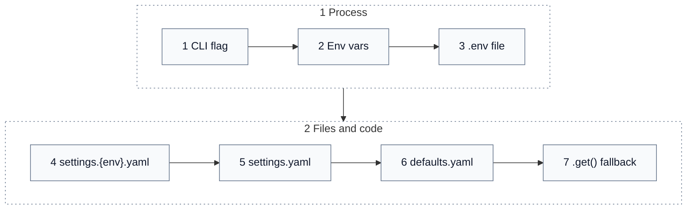

# Config

Seven-layer configuration cascade backed by Dynaconf. Import `settings` and read it like a dict: a value resolves through env vars, `.env`, per-environment YAML, base YAML, defaults YAML, and the fallback in your code, in that order. Your CLI flags sit above all of them, because the code that reads a flag decides it before it asks `settings`.

## The cascade

| # | Layer | Source | When it wins |
|---|-------|--------|--------------|
| 1 | CLI args | Your flag, read before `settings` | One-shot runtime override |
| 2 | Env vars | `MYAPP_DATABASE__HOST=...` | Deployment-injected |
| 3 | `.env` file | `./.env` (or `~/.env` + `./.env` with `DOTENV_CASCADE=true`) | Local dev secrets, gitignored |
| 4 | `settings.{env}.yaml` | Per-environment overlay (e.g. `settings.production.yaml`) | Environment-specific |
| 5 | `settings.yaml` | Project base | Team defaults |
| 6 | `defaults.yaml` | Safe fallback | Local dev |
| 7 | Hard-coded | `settings.get("k", "default")` | Last resort |

Nothing maps a CLI flag into `settings`. `ServiceApp` applies three: `--log-level` and `--log-format` outrank `logging.level` and `logging.format`, and `--config` adds a file to the cascade.

A key resolves from the first layer that sets it, and a reload re-reads every layer but `.env`.



*Figure 1. L4 Detail -- Config cascade. Read each stage left to right, then down.* Up: [scalo docs](../README.md).

A reload does not re-read `.env`, whose values went into `os.environ` when it loaded.

### When `.env` loads

Importing scalo reads no `.env` and never writes `os.environ`. Layer 3 loads when the app asks: `get_config()` (default `load_dotenv=True`) or `ServiceApp.cli()`, which loads before parsing so `LOG_LEVEL`, `LOG_FORMAT`, `METRICS_ADDR` and `CLI_CONFIG` see it.

Loaded values go into `os.environ` beneath every variable exported before it, and `settings` reloads if something read it first. An app that reads `settings` alone calls `get_config()` once at startup. `get_config(load_dotenv=False)` skips the layer.

## Read it like a dict

```python
from scalo.config import settings

# Attribute access, dot-separated keys.
brokers = settings.kafka.brokers
batch_size = settings.processor.batch_size

# Dict-style with fallback (recommended for optional keys).
host = settings.get("database.host", "localhost")
timeout = settings.get("api.timeout", 30)
```

An env key names a nested path with a double underscore between levels. A single underscore stays part of the key, so `MYAPP_DATABASE_HOST` sets the top-level key `database_host`, not `database.host`:

| Config path | Env key (prefix `MYAPP`) |
|-------------|--------------------------|
| `database.host` | `MYAPP_DATABASE__HOST` |
| `cache.disk.enabled` | `MYAPP_CACHE__DISK__ENABLED` |
| `kafka.brokers` | `MYAPP_KAFKA__BROKERS` |

The prefix is fixed when the settings object is built. The module-level `settings`, and `get_config()` called without `env_prefix`, take it from the `ENV_PREFIX` env var as it stood at import, else no prefix at all, so the key above is just `DATABASE__HOST`. `get_config(env_prefix="MYAPP")` takes it per call, and that is what `ServiceApp` does with its `env_prefix` class attribute: the `config` it hands `run_service` is prefixed, the module-level `settings` is not unless `ENV_PREFIX` was exported. scalo hard-codes no brand.

## Multi-file discovery

For each YAML layer (`defaults`, `settings`, `settings.{env}`), scalo-py searches these directories in order:

1. `./` -- current directory
2. `./config/` -- project config subdir
3. `/config/` -- container ConfigMap mount
4. `~/.config/{app_name}/` -- XDG user config, only when the app name is not the `"app"` fallback
5. the mount config directory `get_mount_config()` resolves, when it is not in the list yet

Both `.yaml` and `.yml` are read, `.yaml` first, so a `.yml` in the same directory wins a tie. Every file found is loaded, later overriding earlier. `get_config()` deep-merges them. The module-level `settings` does not: a later file that sets `database` replaces the whole `database` mapping an earlier file set.

YAML values are read as written, except Dynaconf's `@` tokens (`@int 5` reads back as `5`). `${POSTGRES_HOST:-localhost}` arrives as that literal string, so override a file value from the environment with its env key (layer 2) instead.

App name resolves from the bare `APP_NAME` env var (the K8s/Docker convention), then the prefix-aware `<PREFIX>_APP_NAME`, then the program name, then `"app"`. The program name is the top-level package for `python -m pkg[.mod]`, else the stem of the script or console entry point, with underscores turned into hyphens. `python -c`, `python -`, an empty `argv[0]`, `__main__`, `pytest` and `python` give no name. Nothing is imported to guess one, so set `APP_NAME` wherever the name matters.

App environment resolves from `APP_ENV`, `ENVIRONMENT`, `ENV`, then `"development"` -- each candidate is trimmed, and a blank value is treated as unset.

## Hot-reload

`ConfigReloader` polls Dynaconf at a configurable interval (default 5 seconds) and re-reads on SIGHUP (on by default):

```python
from scalo.config import ConfigReloader, ReloaderConfig

def on_reload(settings):
    logger.info("config reloaded", brokers=settings.kafka.brokers)

reloader = ConfigReloader(
    ReloaderConfig(poll_interval=30.0, enable_sighup=True),
    on_reload=on_reload,
    validate_fn=lambda s: s.kafka.brokers,    # reject empty brokers
)
await reloader.start()
# ... app runs ...
await reloader.stop()
```

Each reload loads the cascade into a copy of the settings, and `validate_fn` checks the copy. Only a copy that loads and validates replaces the live `settings`, so a reload that fails to load, fails validation or raises in `validate_fn` leaves the last good config in place. `on_reload` then receives the live `settings`. The reloader reloads the module-level `settings` only, never an object `get_config()` returned, `ServiceApp`'s `config` included.

`reload_count_success` and `reload_count_error` are counters you can feed into [AppMetrics.record_config_reload](metrics.md#built-in-metric-groups). The reloader does not do it for you -- it imports nothing from `metrics` or `health`, so read the properties and record them from your code.

SIGHUP is registered whenever `enable_sighup` is set, independently of `poll_interval`, so "reload on SIGHUP, never poll" works. It is a no-op on Windows and off the main thread.

## Cross-cutting envs

These bypass the cascade and change scalo-py's behaviour. Most are read as `<PREFIX>_<NAME>` when a prefix is set and bare otherwise. The prefix a knob sees is the one active when it is read: `AUTO_DETECT` and the prefixed `APP_NAME` are read at import, so `ENV_PREFIX` alone reaches them, and the rest are read later and see `ServiceApp`'s prefix as well.

| Var | Effect | Default |
|-----|--------|---------|
| `APP_NAME` | Service name (used in paths). Read bare first, then prefixed | program name, else `app` |
| `ENV_PREFIX` | Env var prefix for everything else. Always bare | bare (no prefix) |
| `DEBUG` | Verbose config-loading debug logs | unset |
| `DOTENV_CASCADE` | Add `~/.env` beneath `./.env` when the `.env` layer loads | `false` |
| `AUTO_DETECT` | Auto-detect container/runtime environment | `true` |
| `CONTAINER_BASE_PATH` | Base of the container paths `get_runtime_paths()` returns. Always bare | `/app` |
| `METRIC_PREFIX` | Prefix on scalo's built-in metrics | bare (no prefix) |
| `METRICS_BACKEND` | `opentelemetry` or `prometheus` | `opentelemetry` |

The CLI's flag envs are read bare whatever the prefix, the same names scalo-rs reads: `LOG_LEVEL` (`--log-level`), `LOG_FORMAT` (`--log-format`), `METRICS_ADDR` (`--metrics-addr`) and `CLI_CONFIG` (`--config`). With `ENV_PREFIX=MYAPP`, `MYAPP_LOG_LEVEL` does nothing. Below the flag, the level comes from the cascade key `logging.level`.

## Container-aware paths

`get_mount_config()` returns a `MountConfig` dataclass with paths that follow the detected environment.

```python
from scalo.config import get_mount_config

mounts = get_mount_config()
config_file = mounts.config_dir / "app.yaml"
data_file = mounts.data_dir / "state.db"
```

The defaults below apply when nothing better exists. In a container, the first existing directory from the field's list in `detect_standard_mounts()` wins over the default, so an image with `/var/log` gets `logs_dir=/var/log` and the system temp dir always wins `temp_dir`.

| Mount | K8s, Helm | K8s, other | Docker / container | Local |
|-------|-----------|------------|--------------------|-------|
| `config_dir` | `/config` | `/app/config` | `/app/config` | `~/.config/{app}` |
| `secrets_dir` | `/secrets` | `/app/secrets` | `/run/secrets` | `~/.{app}/secrets` |
| `data_dir` | `/data` | `/app/data` | `/app/data` | `~/.local/share/{app}` |
| `logs_dir` | `/logs` | `/app/logs` | `/app/logs` | `~/.local/share/{app}/logs` |
| `temp_dir` | `/tmp` | `/tmp` | `/tmp` | `/tmp/{app}` |
| `cache_dir` | detected, else none | detected, else none | `/app/cache` | `~/.cache/{app}` |
| `run_dir` | detected, else none | detected, else none | `/run/{app}` | `/run/user/{uid}/{app}` |

Helm means `HELM_RELEASE_NAME` is set, two of `/config`, `/secrets` and `/data` exist, or `/etc/podinfo/labels` has `app.kubernetes.io/managed-by=Helm`. The layout is computed once, at import, and no directory is created, so create the ones you write to.

The environment is a container only on container evidence: a K8s service-account directory, `KUBERNETES_SERVICE_HOST`, `/.dockerenv`, a container cgroup in `/proc/1/cgroup` or `/proc/self/cgroup`, an overlay root mount built by docker, containerd or kubelet, or the `container`, `DOCKER_CONTAINER` or `ECS_CONTAINER_METADATA_URI` env var. A host directory such as `/cache` or `/data`, and the container mounts a docker host lists in its mountinfo, do not make the host a container. `AUTO_DETECT=false` skips detection and uses a fixed layout: `/app/config`, `/app/secrets`, `/app/data`, `/app/logs` and the system temp dir. See [runtime/runtime-context.md](../runtime/runtime-context.md) for the checks in order.

## Sensitive masking

scalo has no `/config` endpoint, and `config-check` prints the service name, the config path, the log level and format, and the metrics address.

The config accessors return values as set, unmasked: `settings.database.password` is the password, and `get_container_config()` and `get_standard_env_vars()` include `POSTGRES_PASSWORD`, `MYSQL_PASSWORD`, `MONGO_PASSWORD` and `CLICKHOUSE_PASSWORD` when the environment sets them.

The logger masks a value by its key, at any depth: `logger.info("loaded", database=settings.database)` logs `database.password` as `***REDACTED***`, and `get_container_config()` logged the same way loses its passwords. Code that prints config or serves it checks each key with `scalo.logger.filters.is_credential_name(name, parent)`, the matcher the logger uses, and masks a URL password in a value with `scalo.logger.filters.mask_url_userinfo`. See [scrubbing.md](scrubbing.md#layer-2-field-name-regex).
