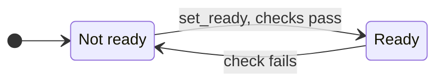

# Health

Kubernetes-style probe endpoints. Instantiate `HealthManager`, register downstream checks, serve it, and the service exposes `/livez` and `/readyz`, each returning a 200 JSON body when healthy and a 503 with check details when not. The manager needs no extra, and the FastAPI router factory imports FastAPI lazily so the module installs without it.

```python
from fastapi import FastAPI
from scalo.health import HealthManager, create_health_router

health = HealthManager()
# fastapi 0.142+ otherwise reads OTEL_EXPORTER_OTLP_ENDPOINT and adds http/protobuf exporters, which fail against a gRPC collector.
app = FastAPI(telemetry={"auto_configure": False})
app.include_router(create_health_router(health))

# Wire downstream checks.
health.register_ready_check("postgres", lambda: db.is_connected())
health.register_ready_check("cache", cache.ping_async)

# Flip the gate once init completes.
health.set_ready()
```

## Two probes, and startup on the first

| Probe | Path | 200 when | 503 when | Purpose |
|-------|------|----------|----------|---------|
| Liveness | `/livez` | All registered liveness checks pass (or none registered) | A check returns false, raises or times out | K8s restarts the pod |
| Readiness | `/readyz` | `set_ready()` called AND all readiness checks pass | Either gate fails | K8s removes pod from Service |
| Startup | none -- probe `/livez` | -- | -- | K8s defers liveness until it passes |

A check is a sync function, an `async def`, or any callable that returns a coroutine (`lambda: client.ping_async()`, an object with an async `__call__`). The coroutine is awaited within the check's timeout, so its result counts, not the coroutine object. Each check gets a separate timeout, `per_check_timeout` on `register_ready_check` / `register_live_check`, else the manager's `default_check_timeout` of 2 seconds. The probe endpoints run every check concurrently, so one slow downstream doesn't fail the others.

Liveness defaults to "alive" when no checks are registered -- the process is running, that's enough. Readiness defaults to NOT ready until you explicitly call `set_ready()`. This matters for K8s rolling updates: the pod stays out of the load balancer until your init code finishes connecting to downstreams.

The response body:

```json
{
  "status": "ready",
  "timestamp": "2026-05-25T10:30:00.123456+00:00",
  "checks": {
    "postgres": true,
    "cache": true
  }
}
```

Failed probes return the same body with `"status": "not_ready"` (or `"not_alive"`) and the failing check set to `false`. Timestamps are RFC 3339 with UTC offset. Checks that raise are treated as `false` -- the manager catches every exception so one broken check never takes the probe with it.

## Paths and the K8s probe spec

`/livez` and `/readyz` are the whole surface, and scalo-rs serves the same names. The `*z` suffix keeps probe routes visually distinct from application routes. There are no aliases: both the observability server and the FastAPI router return 404 for every retired spelling (`/healthz`, `/health/live`, `/health/ready`, `/health/startup`, `/startupz`), and the tests assert it. A second path meaning the same thing eventually stops meaning the same thing, and an alias that keeps answering 200 hides a probe still pointed at the old name.

There is **no startup path**. Aim `startupProbe` at the liveness path -- Kubernetes suspends liveness until the startup probe passes, so one path gives both a boot budget and a tight liveness period without the two drifting apart.

`/livez` answers 200 once the listener binds, which `ServiceApp` does before `run_service`, unless a liveness check fails. So the budget covers the start up to the bind, and the liveness period governs a slow `run_service`. To hold the startup probe until initialisation finishes, register a liveness check that returns false until then before `cli()` runs, for example through `self.health()` in the subclass's `__init__`.

Probe the **observability port**, not the traffic port: exposing the application must not expose the operator surface. The scalo-service chart renders these probes from the contract's `health` block, with the startup budget from `startup_budget_seconds` (default 150):

```yaml
livenessProbe:
  httpGet:
    path: /livez
    port: metrics       # the observability port (9090), NOT http
  periodSeconds: 10
  timeoutSeconds: 3
  failureThreshold: 3

readinessProbe:
  httpGet:
    path: /readyz
    port: metrics
  periodSeconds: 5
  timeoutSeconds: 3
  failureThreshold: 2

startupProbe:
  httpGet:
    path: /livez      # reuses liveness, by design
    port: metrics
  periodSeconds: 5
  timeoutSeconds: 3
  failureThreshold: 30      # startup_budget_seconds / 5s
```

`startupProbe`, `livenessProbe` and `readinessProbe` in the chart's values merge over each.

## Serving the probes

Two ways, and the first is the one you want.

**Dedicated observability port (recommended).** `ServiceApp` binds `--metrics-addr` (default `0.0.0.0:9090`) during `run` and serves `/metrics`, `/livez` and `/readyz` there. Register checks and flip readiness on the manager it hands you, or `/readyz` will report something the service does not mean:

```python
class MyService(ServiceApp):
    name = "my-service"
    env_prefix = "MYAPP"

    def run_service(self, config):
        self.health().register_ready_check("db", db.is_connected)
        self.health().set_ready()
        ...
```

Outside `ServiceApp`, do the same directly:

```python
from scalo.health import HealthManager, serve_observability

health = HealthManager()
server = serve_observability(health, metrics, "0.0.0.0:9090")
```

That listener is built on the standard library's `http.server`, so it needs no extra and no FastAPI.

**App-mounted router.** `create_health_router` still exists for services that want the probes on their FastAPI app. Be aware this puts the operator surface behind the same ingress as user traffic -- which is how an unauthenticated `/metrics` ends up on a public API port.

## Readiness and the started flag

`set_started()` records that init finished, and `is_started()` and `startup_response()` report it. No endpoint serves it and readiness does not depend on it, so the probes ignore it. `ServiceApp` sets it before `run_service`.

Readiness starts off and turns on once `set_ready()` has run and every readiness check passes.



*Figure 1. L4 Detail -- Readiness.* Up: [scalo docs](../README.md).

`set_ready(False)` takes the manager back to not ready as well, the way a check failing does.

Liveness is independent of this -- the manager tracks it as a separate set of checks that K8s polls regardless of readiness state.

## Without FastAPI

The manager is pure Python. If you use Starlette, Flask, or a custom framework, wire the responses directly:

```python
health = HealthManager()

# Your framework's async handler:
async def liveness_handler():
    resp = await health.liveness_response_async()
    status = 200 if resp["status"] == "alive" else 503
    return JSONResponse(resp, status_code=status)
```

The async responses (`liveness_response_async()`, `readiness_response_async()`) and checks (`is_live_async()`, `is_ready_async()`) enforce each check's timeout. The sync ones (`liveness_response()`, `readiness_response()`, `startup_response()`, `is_live()`, `is_ready()`, `is_started()`) call each check in turn. A sync check gets no timeout, so a hung one blocks the caller, and an async check called on the sync path runs on a fresh event loop within its timeout.
