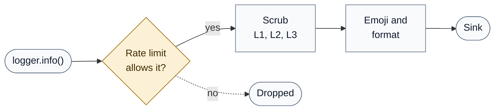

# Logger

Loguru-backed structured logging with RFC 3339 timestamps, layered secret scrubbing, rate-limiting, and CI-aware output formatting. Call `setup()` once, or let `ServiceApp` call it, and every message goes through the rate-limit filter (when one is set), the scrub pipeline, and finally a sink chosen by the detected runtime (TTY, container, or CI). No `logging.basicConfig`, no `dictConfig`, no per-service boilerplate.

```python
from scalo.logger import error, info, logger, setup

setup()
info("service started", version="1.4.0")
logger.bind(component="kafka_consumer").info("subscribed", topic="events")

try:
    process()
except Exception:
    error("processing failed", retries=3)
```

Three layers scrub every message, field and traceback before a sink writes it: L1 secrets from the gitleaks rule set, L2 credential field names, and L3 PII values. Every level is scrubbed by default, and `log_levels` turns a level off, though a field with a credential name is masked at every level. [scrubbing.md](scrubbing.md) has the layers, the rules each one applies, and how to exclude a rule.

## Format selection

The console sink writes JSON or text. The first concrete selector wins: the `log_format` argument (`--log-format` on a `ServiceApp`), then `LOG_FORMAT`, then `logging.format`. `auto`, blank and unrecognised values defer to the next one.

| Selector | Output |
|----------|--------|
| `json` | One flat JSON object per line, see [JSON records](#json-records) |
| `text` | A human-readable line with the fields as `key=value`. `console`, `pretty` and `human` are aliases |
| `auto`, or nothing set | JSON when `OTEL_EXPORTER_OTLP_ENDPOINT` is set, text in CI, text when stderr is a TTY, JSON otherwise |

So a service in a container logs JSON with no configuration, and the same code in a terminal logs text. An unrecognised value is treated as `auto` and reported with a warning once the sinks are up. `json`, `text`, `pretty`, `human` and `auto` are the values scalo-rs accepts as well, and `console` is scalo-py's alone.

Importing `scalo.logger` installs nothing, so a library that imports scalo never replaces its host's logging. `AUTO_LOGGER_CONFIG=1` runs `setup()` on import instead, without span export, and `NO_LOGGER_CONFIG=1` vetoes that.

Until `setup()` runs, records go to loguru's default stderr sink. Importing scalo rebuilds that sink with `diagnose=False`, because loguru's default prints every local variable of a logged traceback, secrets included. A `LOGURU_DIAGNOSE` you set is left to decide, and an app that removed the sink before importing scalo gets none back. The rebuilt sink has a new id, so remove it with `logger.remove()`, not `logger.remove(0)`.

## Fields

Keyword arguments and `logger.bind()` context are the record's fields, and every format renders them.

- Text appends them after the message as `key=value`. A value is quoted, JSON-style, when it is empty or holds a space, `=`, `"` or a control character. Non-string values render as JSON: `true`, `null`, `3`. A record with no fields gets nothing appended.
- JSON puts them under `fields`.

```text
2026-10-01T20:47:42.256+1000 | WARNING  | app.tls:load:7 - key rejected stderr="openssl: bad key" sigma_id=abc123
```

The scrub filter runs on the fields before either format sees them. A key naming a credential masks its value at any depth. A name is a credential by the rule in [Layer 2](scrubbing.md#layer-2-field-name-regex). Keys and strings are scrubbed at any depth, any other object is rendered with `str()` and then scrubbed, and NaN and the infinities become the strings `"NaN"`, `"Infinity"` and `"-Infinity"`.

Such a name heading a pair masks the value beside it. A pair is a two-item tuple such as `("authorization", "Basic ...")`, or a two-item list inside a list or tuple, as a JSON header list holds them. A two-item list under a key is a list, so `{"fields": ["email", "name"]}` is logged whole, but a tuple of two names, `("email", "name")`, has its second masked.

The filter never fails the record. A value whose `str()` raises renders as `<unprintable TypeName>`, a reference cycle as `<cycle>`, and nesting past `_MAX_FIELD_DEPTH` levels as `<depth limit>`. Scrubbing runs on the caller's thread, so a record scrubs at most `_FIELD_SCRUB_BUDGET` keys and strings inside its fields' containers (both constants in `src/scalo/logger/logger.py`). Past that, the rest of each list becomes `"<elided: N more items>"` and the rest of each dict an `"<elided>"` entry. Top-level fields are never elided.

After the filter has run, `record["extra"]` holds the scrubbed fields as plain JSON data, which is what a sink you add yourself sees.

## JSON records

```json
{"timestamp": "2026-10-01T10:47:34.727003Z", "level": "WARNING", "target": "app.tls", "function": "load", "line_number": 7, "message": "key rejected", "fields": {"stderr": "openssl: bad key", "sigma_id": "abc123"}}
```

| Key | Content |
|-----|---------|
| `timestamp` | RFC 3339 in UTC, microseconds |
| `level` | loguru level name: `TRACE`, `DEBUG`, `INFO`, `SUCCESS`, `WARNING`, `ERROR`, `CRITICAL` |
| `target` | Logger name: the calling module |
| `function`, `line_number` | Call site |
| `message` | The scrubbed message, emojis as ASCII tokens |
| `fields` | The record's fields as an object, `{}` when there are none |
| `exception` | The traceback as the stdlib formats it, scrubbed, present when one was logged |

Fields sit under one key so a field called `level` or `message` cannot overwrite the record's keys. `timestamp`, `level`, `target`, `line_number` and `fields` are keys scalo-rs writes as well. In scalo-rs `message` sits inside `fields`, there is no `function`, a warning is `WARN`, and a record has `filename` and, when the service sets them, `service` and `version`.

Text is coloured when stderr is a TTY and not otherwise. `LOG_COLOR` (`true`/`false`) wins, then `NO_COLOR` (set to anything turns colour off), then `logging.color`, then the TTY check. JSON and CI output are never coloured.

## Level and environment

```bash
LOG_LEVEL=DEBUG              # DEBUG, INFO, WARNING, ERROR, CRITICAL
LOG_FORMAT=json              # json, text, auto (console, pretty, human mean text)
LOG_COLOR=false              # true/false; NO_COLOR=1 also turns colour off
LOG_ENQUEUE=0                # Sync sinks (default: fire-and-forget)
```

`logging.intercept_stdlib` (default `true`) is read from config, see [Library and stdlib loggers](#library-and-stdlib-loggers). `get_logging_config()` reads `LOG_OUTPUT`, `LOG_TIMESTAMP_FORMAT`, `LOG_CALLER` and `LOG_STACKTRACE_LEVEL`, but `setup()` does not apply them: the console sink always writes to stderr, with RFC 3339 timestamps and the call site.

`AUTO_LOGGER_CONFIG`, `NO_LOGGER_CONFIG` and `LOG_ENQUEUE` are scalo control vars, so they take the env prefix: bare by default, `<PREFIX>_LOG_ENQUEUE` under a prefix. `AUTO_LOGGER_CONFIG` and `NO_LOGGER_CONFIG` are read at import, so `ENV_PREFIX` alone reaches them. There is no `HYPERI_` form -- scalo hard-codes no brand.

The level, format and colour live under `logging:` as well, in `settings.yaml` (`level`, `format`, `color`) and follow the [config cascade](config.md#the-cascade).

On the `ServiceApp` path the level comes from these, highest first:

1. `--verbose` / `--quiet`
2. `--log-level` (Typer fills this from `LOG_LEVEL` as well)
3. `logging.level` in the config cascade
4. `INFO`

`--log-level` and `--log-format` have no default, deliberately: a default is indistinguishable from an explicit flag, so one would outrank the cascade permanently. scalo-rs's flags have none either.

`run` and `config-check` load config before they build the logger, so its level and format can come from the loaded config, a `--config` file included. Span export reads the module-level `settings`, which `ServiceApp` has by then made that loaded config, see [tracing.md](tracing.md#on-by-default-and-the-settings). Anything the cascade logs on the way up goes to loguru's default sink, unscrubbed. Those lines are DEBUG-gated, and the resolved config path is logged once the sinks are up.

## Library and stdlib loggers

`setup()` raises the stdlib `boto3`, `botocore`, `s3transfer`, `urllib3`, `httpx` and `httpcore` loggers to WARNING, whatever `level` is. At DEBUG botocore writes request params and response bodies, and a Secrets Manager `SecretString` is one of them. At INFO httpx writes every request URL whole, so a presigned S3 or SAS URL goes out with its signature. A level the app set higher before `setup()` is left alone. Need their DEBUG output? Set the logger's level yourself AFTER `setup()`, and never where something reads a secret.

Libraries that log through the stdlib `logging` module -- uvicorn, clickhouse_connect, botocore, and scalo's secrets and config reloader -- go through the same sinks. `setup()` replaces the root logger's handlers with one that re-emits each record through loguru, so it gets the same format, the same scrubbing, and its `extra=` dict as fields. The call site reported is the library's, not the handler's.

- The root logger's other handlers are removed, so nothing is written twice. The root level follows `level`.
- `uvicorn`, `uvicorn.error`, `uvicorn.access` and `detect-secrets` lose their handlers and propagate.
- uvicorn reattaches its handlers whenever a `uvicorn.Config` is built, so build it with `log_config=None` after `setup()`.
- A handler a library attaches after `setup()` still writes unscrubbed, and `logging.basicConfig(force=True)` removes the bridge altogether.

It is on by default. Turn it off with `logging.intercept_stdlib: false` or `setup(intercept_stdlib=False)`, which removes a handler an earlier `setup()` installed as well.

## CI and emoji output

`setup()` switches to ASCII-only output and disables colours when any of these are set: `CI=true`, `GITHUB_ACTIONS=true`, `GITLAB_CI=true`, `JENKINS_URL`, `CIRCLECI=true`, `TRAVIS=true`. GitHub Actions gets a custom sink that emits workflow commands -- `::error::`, `::warning::`, `::debug::` -- so log messages annotate the run UI.

CI mode implies `use_emojis=False`. Override via `setup(ci_mode=False)` if you really need colours in CI. CI turns `auto` into text, and an explicit `json` still writes JSON.

A `logging.ci_mode` config key does nothing: `setup()` honours the `ci_mode` keyword argument or its environment auto-detect and nothing else, so set it there instead.

Level emojis (✅ ❌ ⚠️ 💥) are added to text console output on an interactive terminal: stderr a TTY, `TERM` set and not `dumb`, a UTF-8 locale, and not CI. For file sinks, CI mode, and JSON, emojis are converted to ASCII tokens:

| Emoji | ASCII |
|-------|-------|
| 💥 | `[FATAL]` |
| ❌ | `[ERROR]` |
| ⚠️ | `[WARN]` |
| ✅ | `[SUCCESS]` |
| 🟢 | `[PASS]` |
| 🔴 | `[FAIL]` |
| 🔁 | `[RETRY]` |

The conversion table is `EMOJI_TO_TEXT` in `scalo.logger.logger`. Use `emojis_to_text()` or `strip_emojis()` from `scalo.logger` directly when needed.

## Rate limiting and the record path

`RateLimitFilter` suppresses identical messages from tight loops and reports the suppressed count when logging resumes:

```python
from scalo.logger import setup

setup(rate_limit_sec=30, rate_limit_similar=True)

for order_id in range(1000):
    logger.error(f"Failed to process order_id={order_id}")
# First message fires; the next 999 are suppressed.
# When the period elapses, the next message includes
# "(suppressed 999 similar)".
```

`rate_limit_similar=True` normalises UUIDs, ISO timestamps, hex strings of 8 or more characters, IPv4 addresses, numbers of 4 or more digits, and a number straight after `=` or `#` before matching. `order 42` and `order 43` stay distinct, but `order_id=42` and `order_id=43` collapse to one. The key is the logger name, the level and the (normalised) message.

A `logging.rate_limit_sec` config key does nothing: pass `rate_limit_sec=` to `setup()` directly instead.

`setup()` builds its sinks with `enqueue=True`, so a log call returns without waiting on a slow disk or network sink. Set `LOG_ENQUEUE=0` for synchronous sinks, which audit logs and pytest fixtures asserting on captured output need.

A record passes the rate limit, then the scrubber, then the emoji conversion and the formatter, and a suppressed record never reaches the scrubber.



*Figure 1. L4 Detail -- Log record path. The no arrow is a suppressed record.* Up: [scalo docs](../README.md).

The sink is stderr, a file, or the GitHub Actions sink in a workflow.
