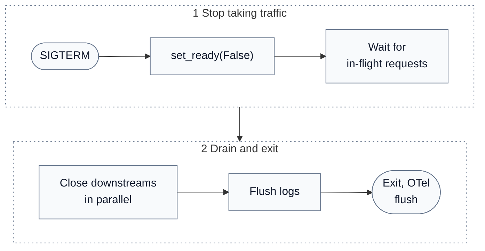

# Shutdown

scalo-py installs no signal handlers, and neither does `ServiceApp`, which turns Ctrl-C into a clean exit and leaves SIGTERM to Python's default. Shutdown ordering is the app's job. What scalo-py ships is the set of pieces every shutdown path needs: `gather_with_timeouts` for parallel drain with per-task budgets, bounded `atexit` flushes for OTel metrics and spans, and the readiness flag on `HealthManager` so K8s removes the pod from the load balancer before the drain starts. Wire these into your SIGTERM handler and the pod exits inside its termination grace period.

```python
import signal
import asyncio
from scalo.concurrency import gather_with_timeouts, run_blocking
from scalo.logger import logger

shutdown_event = asyncio.Event()

def handle_sigterm(*_):
    shutdown_event.set()

signal.signal(signal.SIGTERM, handle_sigterm)
signal.signal(signal.SIGINT, handle_sigterm)

async def main():
    # ... start service ...
    await shutdown_event.wait()
    await drain()

async def drain():
    health.set_ready(False)           # K8s stops routing
    await asyncio.sleep(5)             # in-flight requests finish
    results = await gather_with_timeouts(
        {
            "kafka": lambda: run_blocking(producer.flush, 10.0),
            "db": lambda: db.close(),
            "cache": lambda: cache.close(),
        },
        per_task_timeout=12.0,
    )
    if results["kafka"] != 0:          # messages still queued, or the exception that stopped the flush
        logger.error("kafka drain incomplete", result=repr(results["kafka"]))
```

`health` is the `HealthManager` your probes read (`self.health()` in a `ServiceApp`). Each value given to `gather_with_timeouts` must return an awaitable: `KafkaProducer.flush` is synchronous, so it goes through `run_blocking`, and `AsyncKafkaProducer.flush` can go in as is. `gather_with_timeouts` returns each task's result or the exception that stopped it, and `flush` returns the count of messages still queued, so anything but 0 means undelivered messages. The task budget sits above the flush timeout so the flush answers first.

## The K8s shutdown sequence

K8s shutdown is a six-step sequence the app cannot skip. The pod gets `terminationGracePeriodSeconds` from SIGTERM to exit (the Kubernetes default is 30s, and the scalo-service chart sets it from its `terminationGracePeriodSeconds` value, else the contract's `termination_grace_seconds`, default 45). Miss it and K8s SIGKILLs the process.

| # | Actor | Action | scalo-py piece |
|---|-------|--------|----------------|
| 1 | K8s | Sends SIGTERM to PID 1 | -- |
| 2 | K8s | Removes pod from Endpoints (eventual, ~5s) | -- |
| 3 | App | Flips `/readyz` to 503 | `health.set_ready(False)` |
| 4 | App | Waits for in-flight requests to drain | `asyncio.sleep(preStop_delay)` |
| 5 | App | Closes downstreams in parallel | `gather_with_timeouts(...)` |
| 6 | App | Process exits | `sys.exit(0)` |

The Endpoints removal is asynchronous, and ingress controllers and kube-proxy keep separate caches. Step 3 (flip readiness) changes what `/readyz` answers, and the kubelet sees it at its next readiness probe: with the chart's probe (`periodSeconds: 5`, `failureThreshold: 2`) that takes up to 10 seconds, and the Endpoints change then propagates as above. So the wait in step 4 must cover the probe period and the propagation, not the in-flight requests alone.

A `preStop` hook runs before SIGTERM is sent. Use it to give the service mesh time to remove the pod before the app starts draining:

```yaml
spec:
  terminationGracePeriodSeconds: 30
  containers:
    - name: my-service
      lifecycle:
        preStop:
          exec:
            command: ["sleep", "5"]
```

5 seconds is the rough rule for kube-proxy iptables refresh + service-mesh sidecar drain. The app doesn't see SIGTERM until the sleep finishes, so in-flight requests have time to land.

If you can't add `preStop`, wire the same delay into the drain:

```python
async def drain():
    health.set_ready(False)
    await asyncio.sleep(5)        # equivalent to preStop sleep
    # ... close downstreams ...
```

## Parallel drain with budgets

`gather_with_timeouts` runs every drain task concurrently, each with a separate timeout. One slow downstream doesn't extend the total drain, and exceptions are captured per-task and returned alongside results.

```python
from scalo.concurrency import gather_with_timeouts, run_blocking

results = await gather_with_timeouts(
    {
        "kafka_flush": lambda: run_blocking(producer.flush, 10.0),
        "db_close": lambda: db.close(),
        "cache_close": lambda: cache.close(),
        "secrets_close": lambda: secrets.close(),
    },
    per_task_timeout=10.0,
)
for name, result in results.items():
    if isinstance(result, Exception):
        logger.warning("drain task failed", task=name, error=str(result))
```

Pass factories (`lambda: producer.flush(...)`) not coroutines -- factories let the helper cancel cleanly on timeout. `SecretsManager.close()` is async.

Producer buffers can hold thousands of records at SIGTERM. Outside the event loop, flush synchronously with a timeout matching your drain budget:

```python
def drain_kafka():
    # Returns the number of messages still queued, 0 when all were delivered.
    remaining = producer.flush(timeout=10.0)
```

A `with KafkaProducer(...) as producer:` block flushes, with no timeout, when it exits. See [transport/kafka.md](../transport/kafka.md#async-clients) for the async producer/consumer drain pattern.

## OTel and log flush

The OTel metrics backend builds its `MeterProvider` with the SDK's exit hook turned off and registers an `atexit` hook of scalo's instead. It shuts each metric reader and then the provider down, each bounded at 2 seconds, and ignores export errors, so a collector that is unreachable at shutdown costs the unsent metrics and nothing else. No app code is needed.

Span export registers a second `atexit` hook when `logger.setup()` turns it on. It flushes buffered spans and stops the tracer provider, bounded at 2 seconds for both, and drops what is still queued at the bound. See [tracing.md](tracing.md#bounded-so-a-missing-collector-costs-telemetry-and-nothing-else).

scalo's sinks are enqueued by default (`enqueue=True`, written on a background thread). Flush them as the last drain step:

```python
async def drain():
    # ... other drain steps ...
    logger.complete()         # flush any pending records
    logger.remove()           # stop sinks
```

Set `LOG_ENQUEUE=0` (`<PREFIX>_LOG_ENQUEUE` under a prefix) for synchronous sinks if you need guaranteed ordering with stdout (CI test capture, audit logs). See [logging.md](logging.md#rate-limiting-and-the-record-path).

## The grace period budget

The app stops taking traffic before it drains, and the OTel flush runs last, at exit.



*Figure 1. L4 Detail -- Shutdown sequence. Read each stage left to right, then down.* Up: [scalo docs](../README.md).

`terminationGracePeriodSeconds` must cover (`preStop sleep`) + (in-flight request budget) + (drain per_task_timeout) + (the OTel flush bounds). For the example above: 5s preStop + up to 10s for the readiness probe to notice + 10s drain + up to 8s OTel (2s for each of the two metric readers, 2s for the meter provider, 2s for spans) = 33s, inside the contract default of 45s.

## What scalo-py does NOT do

- Install signal handlers. SIGTERM and SIGINT are the app's, `ServiceApp` included.
- Auto-flip readiness on shutdown. You must call `set_ready(False)`.
- Flush Kafka producers on SIGTERM. The producer lifecycle is app-specific.
- Auto-close database pools. Connection ownership lives in app code.

The process-wide hooks scalo-py registers are the two OTel `atexit` flushes, once metrics or span export is set up, and nothing else. They replace the SDK's hooks, which have a 30-second timeout an unreachable collector would spend in full.
