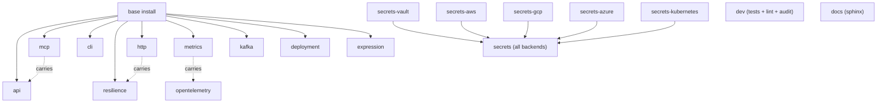

# Extras flags

Python equivalent of scalo-rs's [feature flags page](https://github.com/hyperi-io/scalo-rs/blob/main/docs/feature-flags.md). Where scalo-rs uses cargo features, scalo-py uses [PEP 631 extras](https://peps.python.org/pep-0631/): install what you need, pay nothing for what you don't.

This page covers the base install, which extras pull in which deps, native deps, and recommended bundles. For what an extra does, see the subsystem doc linked in each row.

---

## Base install

```toml
[project]
dependencies = ["scalo"]
```

That gives you:

- 7-layer config cascade (`from scalo import config`)
- Structured logger with autodetect format + secret scrubbing (`from scalo import logger`, then `logger.setup()`)
- Container-aware runtime paths (`from scalo import runtime`)
- Health probe state and the observability listener (`from scalo import health`). `create_health_router` also needs FastAPI
- CLI framework (`from scalo.cli import ServiceApp`)
- Concurrency primitives (`from scalo import concurrency`)
- Version-check probe (`from scalo.version_check import check_on_startup`)

Base runtime deps (transitive): dynaconf, loguru, python-dotenv, pyyaml,
mergedeep, tomli-w, typer, dulwich, anyio, asyncer, detect-secrets,
phonenumbers, python-stdnum, regex.

That's it for the no-extras path. If you only need those, stop here.

---

## Extras tree



Solid arrows: independent extra. A dotted arrow points from an extra to one whose packages it already carries, so there is no need to list both: `mcp` installs `scalo[api]`, `http` carries `stamina`, and `metrics` carries every `opentelemetry` package. The `secrets` extra is a meta-extra that installs every backend at once.

---

## Per-extra detail

### Core observability

| Extra | Adds | Native deps | Doc |
|---|---|---|---|
| `metrics` | `prometheus-client`, `psutil`, `opentelemetry-api`, `opentelemetry-sdk`, `opentelemetry-exporter-otlp`, `opentelemetry-exporter-prometheus` | none | [core-pillars/metrics.md](core-pillars/metrics.md) |
| `opentelemetry` | the four `opentelemetry-*` packages above | none | [core-pillars/metrics.md](core-pillars/metrics.md) |

`metrics` is the one to install: it carries the OTel SDK, so the default
dual-export backend (OTLP push plus `/metrics`) works on that install
alone. `opentelemetry` is a subset of it, kept so existing
`scalo[metrics,opentelemetry]` pins resolve.

### Cross-cutting primitives

| Extra | Adds | Native deps | Doc |
|---|---|---|---|
| `resilience` | `stamina` | none | [api/resilience.md](api/resilience.md) |
| `http` | `httpx`, `stamina` | none | [api/http-client.md](api/http-client.md) |

`http` carries its retry dependency itself, and no `secrets-*` extra pulls `resilience` in. `scalo.resilience` (circuit breaker, reconnecting client) needs no extra and works on the base install.

### API server

| Extra | Adds | Native deps | Doc |
|---|---|---|---|
| `api` | `fastapi`, `pydantic`, `cryptography` | none | [api/api-conventions.md](api/api-conventions.md) |

`scalo.api` holds a FastAPI service to the API conventions: operation ids from one resource hierarchy, the `x-scalo` OpenAPI extension, ETag and If-Match, `dry_run`, problem+json, sealed-token pagination, long-running operations and the conformance check. Base `import scalo` never imports it or FastAPI, and `import scalo.api` without the extra raises an `ImportError` naming `scalo[api]`. `scalo.health.create_health_router` also uses FastAPI, imported only when called.

| Extra | Adds | Native deps | Doc |
|---|---|---|---|
| `mcp` | `mcp`, `httpx2`, `jsonschema`, and the `api` extra | none | [api/mcp.md](api/mcp.md) |

`scalo.mcp` serves MCP tools generated from the app's OpenAPI spec on the same app, over the stateless MCP revision of 2026-07-28. Base `import scalo` never imports it, and `import scalo.mcp` without the extra raises an `ImportError` naming `scalo[mcp]`. The MCP SDK brings `uvicorn` and `sse-starlette` as its own dependencies.

### CLI from a spec

| Extra | Adds | Native deps | Doc |
|---|---|---|---|
| `cli` | `typer`, `jmespath` | none | [api/cli.md](api/cli.md#generated-from-an-openapi-spec) |

`scalo.cli.openapi` builds a whole CLI from an OpenAPI spec: a file or a server's `/openapi.json`, never the app. It imports no FastAPI, uvicorn or mcp. `import scalo.cli.openapi` without the extra raises an `ImportError` naming `scalo[cli]`. `ServiceApp` and the rest of `scalo.cli` stay in the base install, which already carries `typer`.

### Transport + data

| Extra | Adds | Native deps | Doc |
|---|---|---|---|
| `kafka` | `confluent-kafka`, `genson` | `librdkafka` (bundled in confluent-kafka wheels) | [transport/kafka.md](transport/kafka.md) |

### Deployment + identity

| Extra | Adds | Native deps | Doc |
|---|---|---|---|
| `deployment` | `pydantic` | none | [deployment/contract.md](deployment/contract.md) |

`ContractIdentity` and the parity/test-support helpers ship with the
`deployment` extra. The fixture under `tests/fixtures/contract-parity/`
is part of the test suite, not a runtime artefact.

### Expression evaluation

| Extra | Adds | Native deps | Doc |
|---|---|---|---|
| `expression` | `common-expression-language` (a Rust extension built on the `cel` crate) | none (precompiled wheels) | [api/expression.md](api/expression.md), [api/rules.md](api/rules.md) |

It evaluates CEL on the same `cel` crate scalo-rs's `expression` feature compiles against, so an expression means the same thing in either language.

The same extra carries `scalo.rules`, the ordered rule sets scalo-rs builds behind its `rules` feature. Importing `scalo.rules` without it raises `ImportError` naming the extra.

### Secrets

| Extra | Adds | Native deps | Doc |
|---|---|---|---|
| `secrets-vault` | `httpx` | none | [api/secrets.md](api/secrets.md) |
| `secrets-aws` | `boto3`, `aiobotocore` | none | [api/secrets.md](api/secrets.md) |
| `secrets-gcp` | `google-cloud-secret-manager` | none | [api/secrets.md](api/secrets.md) |
| `secrets-azure` | `azure-keyvault-secrets`, `azure-identity` | none | [api/secrets.md](api/secrets.md) |
| `secrets-kubernetes` | `httpx`, `stamina` | none | [api/secrets.md](api/secrets.md#kubernetes-secret) |
| `secrets` | all of the above | none | [api/secrets.md](api/secrets.md) |

Pick the backend(s) you actually use: the meta-extra `secrets` installs every cloud SDK. An installed SDK costs disk, not import time: `import scalo.secrets` loads none, and each loads when its provider is configured.

### Version check

| Extra | Adds | Native deps | Doc |
|---|---|---|---|
| `version-check` | nothing -- the check uses httpx when it is installed and is skipped without it | none | [api/version-check.md](api/version-check.md) |

### Marker extras

`version-check` and `enhanced` pull no dependencies, so listing one installs nothing more than the base.

| Extra | Notes | Doc |
|---|---|---|
| `enhanced` | Empty, installs nothing. | (none) |

### Development

| Extra | Adds | Doc |
|---|---|---|
| `dev` | pytest + asyncio + cov + httpx + ruff + mypy + ty + bandit + pip-audit + vulture + moto + faker + pre-commit | (install for contributing to scalo-py) |
| `docs` | sphinx + rtd-theme + myst-parser | (install for building docs) |

---

## Recommended bundles

### Tooling CLI / one-shot script

```toml
dependencies = ["scalo"]
```

Base install only. Config + logger + runtime + CLI framework.

### FastAPI service (config + logs + metrics + API conventions)

```toml
dependencies = ["scalo[api,metrics]"]
```

### Kafka consumer

```toml
dependencies = [
    "scalo[kafka,metrics,resilience,http,deployment]",
]
```

### Service with Vault secrets

```toml
dependencies = [
    "scalo[kafka,metrics,secrets-vault,resilience,http,deployment]",
]
```

### Multi-cloud service (Vault primary, AWS fallback)

```toml
dependencies = [
    "scalo[kafka,metrics,secrets-vault,secrets-aws,resilience,http,deployment]",
]
```

### Everything (CI test runner, integration suites)

```toml
dependencies = [
    "scalo[kafka,metrics,http,secrets,deployment,expression,resilience,dev]",
]
```

---

## Native deps

No extra needs an apt package. The wheels carry their C libraries (confluent-kafka bundles librdkafka, the CEL wheel its Rust build), and the Dockerfile scalo generates always installs `ca-certificates`. `NativeDepsContract.for_scalo_extras(extras, base_image)` therefore maps no extra to a package and records only the distro release. `for_scalo_features`, for an app that re-binds a scalo-rs core, adds libgit2 for `directory-config-git`. See [deployment/native-deps.md](deployment/native-deps.md).

---

## Notes on pinning

- scalo-py pins minimum versions, not maximum, except where a breaking change in a dependency is known (`sphinx<10` in the `docs` extra).
- `ContractIdentity` and [Contract Identity v1](deployment/identity.md) need scalo 2.28.3 or later.

---

## Related

- [README.md](README.md)
- [architecture.md](architecture.md)
- [integration.md](integration.md)
- [auto-wiring.md](auto-wiring.md)
- [deployment/native-deps.md](deployment/native-deps.md)
