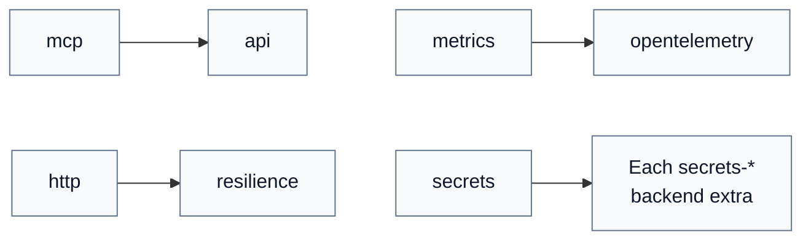

# Extras flags

Python equivalent of scalo-rs's [feature flags page](https://github.com/hyperi-io/scalo-rs/blob/main/docs/feature-flags.md). Where scalo-rs uses cargo features, scalo-py uses [PEP 631 extras](https://peps.python.org/pep-0631/): install what you need, pay nothing for what you don't. This page covers the base install, which extras pull in which deps, native deps and recommended bundles. For what an extra does, see the subsystem doc linked in each row.

## Base install

```toml
[project]
dependencies = ["scalo"]
```

That gives you:

- 7-layer config cascade (`from scalo import config`)
- Structured logger with autodetect format + secret scrubbing (`from scalo import logger`, then `logger.setup()`)
- Container-aware runtime paths (`from scalo import runtime`)
- Health probe state and the observability listener (`from scalo import health`). `create_health_router` needs FastAPI as well
- CLI framework (`from scalo.cli import ServiceApp`)
- Concurrency and resilience primitives: bulkheads, the circuit breaker and the reconnecting wrapper (`from scalo import concurrency, resilience`)
- Version-check probe (`from scalo.version_check import check_on_startup`)
- `ContractIdentity`, which needs no pydantic

Base runtime deps (transitive): dynaconf, loguru, python-dotenv, pyyaml, mergedeep, tomli-w, typer, dulwich, anyio, asyncer, detect-secrets, phonenumbers, python-stdnum, regex. If that is all you need, stop here.

## The extras

| Extra | Adds | Native deps | Doc |
|---|---|---|---|
| `metrics` | `prometheus-client`, `psutil`, `opentelemetry-api`, `opentelemetry-sdk`, `opentelemetry-exporter-otlp`, `opentelemetry-exporter-prometheus` | none | [core-pillars/metrics.md](core-pillars/metrics.md) |
| `opentelemetry` | the four `opentelemetry-*` packages above | none | [core-pillars/metrics.md](core-pillars/metrics.md) |
| `resilience` | `stamina` | none | [api/resilience.md](api/resilience.md) |
| `http` | `httpx`, `stamina` | none | [api/http-client.md](api/http-client.md) |
| `api` | `fastapi`, `pydantic`, `cryptography` | none | [api/api-conventions.md](api/api-conventions.md) |
| `mcp` | `mcp`, `httpx2`, `jsonschema`, and the `api` extra | none | [api/mcp.md](api/mcp.md) |
| `cli` | `typer`, `jmespath` | none | [api/cli.md](api/cli.md#generated-from-an-openapi-spec) |
| `kafka` | `confluent-kafka`, `genson` | `librdkafka` (bundled in confluent-kafka wheels) | [transport/kafka.md](transport/kafka.md) |
| `deployment` | `pydantic` | none | [deployment/contract.md](deployment/contract.md) |
| `expression` | `common-expression-language` (a Rust extension built on the `cel` crate) | none (precompiled wheels) | [api/expression.md](api/expression.md), [api/rules.md](api/rules.md) |
| `secrets-vault` | `httpx` | none | [api/secrets.md](api/secrets.md) |
| `secrets-aws` | `boto3`, `aiobotocore` | none | [api/secrets.md](api/secrets.md) |
| `secrets-gcp` | `google-cloud-secret-manager` | none | [api/secrets.md](api/secrets.md) |
| `secrets-azure` | `azure-keyvault-secrets`, `azure-identity` | none | [api/secrets.md](api/secrets.md) |
| `secrets-kubernetes` | `httpx`, `stamina` | none | [api/secrets.md](api/secrets.md#kubernetes-secret) |
| `secrets` | every `secrets-*` package above | none | [api/secrets.md](api/secrets.md) |
| `version-check` | nothing: the check uses httpx when it is installed and is skipped without it | none | [api/version-check.md](api/version-check.md) |
| `enhanced` | nothing | none | none |
| `dev` | pytest, ruff, mypy, ty, bandit, pip-audit, vulture, moto, faker, pre-commit and the rest of the test and lint tools | none | for contributing to scalo-py |
| `docs` | sphinx, sphinx-rtd-theme, myst-parser, sphinx-autobuild | none | for building docs |

Four extras install every package of another, so list one of each pair rather than both.



*Figure 1. L4 Detail -- Extras that include another. An arrow points at the extra whose packages the left one installs.* Up: [scalo docs](README.md).

`secrets-kubernetes` installs `stamina` as well, the package `resilience` adds.

`metrics` is the one to install for metrics: it has the OTel SDK, so the default dual-export backend (OTLP push plus `/metrics`) works on that install alone. `opentelemetry` is a subset of it, kept so existing `scalo[metrics,opentelemetry]` pins resolve.

`scalo.api` holds a FastAPI service to the API conventions: operation ids from one resource hierarchy, the `x-scalo` OpenAPI extension, ETag and If-Match, `dry_run`, problem+json, sealed-token pagination, long-running operations and the conformance check. Base `import scalo` never imports it or FastAPI, and `import scalo.api` without the extra raises an `ImportError` naming `scalo[api]`. `scalo.health.create_health_router` uses FastAPI as well, imported when called.

`scalo.mcp` serves MCP tools generated from the app's OpenAPI spec on the same app, over the stateless MCP revision of 2026-07-28. Base `import scalo` never imports it, and `import scalo.mcp` without the extra raises an `ImportError` naming `scalo[mcp]`. The MCP SDK brings `uvicorn` and `sse-starlette` as its dependencies.

`scalo.cli.openapi` builds a whole CLI from an OpenAPI spec: a file or a server's `/openapi.json`, never the app. It imports no FastAPI, uvicorn or mcp. `import scalo.cli.openapi` without the extra raises an `ImportError` naming `scalo[cli]`. `ServiceApp` and the rest of `scalo.cli` stay in the base install, which has `typer`.

`expression` evaluates CEL on the same `cel` crate scalo-rs's `expression` feature compiles against, so an expression means the same thing in either language. The same extra serves `scalo.rules`, the ordered rule sets scalo-rs builds behind its `rules` feature. Importing `scalo.rules` without it raises `ImportError` naming the extra.

`deployment` adds the `DeploymentContract` model and the generators. `scalo.deployment.test_support` needs no pydantic but imports pytest, so it loads where the test dependencies are installed. The fixture under `tests/fixtures/contract-parity/` is part of the test suite, not a runtime artefact.

Pick the secrets backends you use: the meta-extra `secrets` installs every cloud SDK. An installed SDK costs disk, not import time: `import scalo.secrets` loads none, and each loads when its provider is configured.

## Recommended bundles

| Service | `dependencies` |
|---|---|
| Tooling CLI or one-shot script: config, logger, runtime and the CLI framework | `["scalo"]` |
| FastAPI service with metrics and the API conventions | `["scalo[api,metrics]"]` |
| Kafka consumer | `["scalo[kafka,metrics,resilience,http,deployment]"]` |
| Service with Vault secrets | `["scalo[kafka,metrics,secrets-vault,resilience,http,deployment]"]` |
| Multi-cloud service, Vault primary and AWS fallback | `["scalo[kafka,metrics,secrets-vault,secrets-aws,resilience,http,deployment]"]` |
| Everything, for a CI test runner or integration suites | `["scalo[kafka,metrics,http,secrets,deployment,expression,resilience,dev]"]` |

## Native deps and pinning

No extra needs an apt package. The wheels hold their C libraries (confluent-kafka bundles librdkafka, the CEL wheel its Rust build), and the Dockerfile scalo generates always installs `ca-certificates`. `NativeDepsContract.for_scalo_extras(extras, base_image)` therefore maps no extra to a package and records the distro release alone. `for_scalo_features`, for an app that re-binds a scalo-rs core, adds libgit2 for `directory-config-git`. See [deployment/native-deps.md](deployment/native-deps.md).

scalo-py pins minimum versions, not maximum, except where a breaking change in a dependency is known (`sphinx<10` in the `docs` extra). `ContractIdentity` and [Contract Identity v1](deployment/identity.md) need scalo 2.28.3 or later.
